# Flow: how `tournament-logic.js` works

For developers and AI assistants. Update this file when the module's flow changes. Conventions
are in [`CLAUDE.md`](CLAUDE.md), user-facing features in [`../README.md`](../README.md).

## 1. Architecture

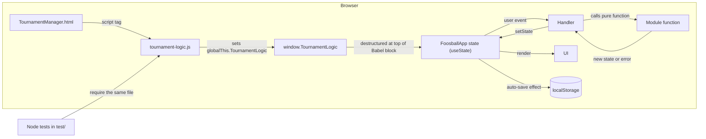

The module is a classic script, not an ES module. Non-determinism (`random`, ids, `fetchImpl`,
`doc`, `now`) is passed in as parameters, so tests control it.

## 2. Page load

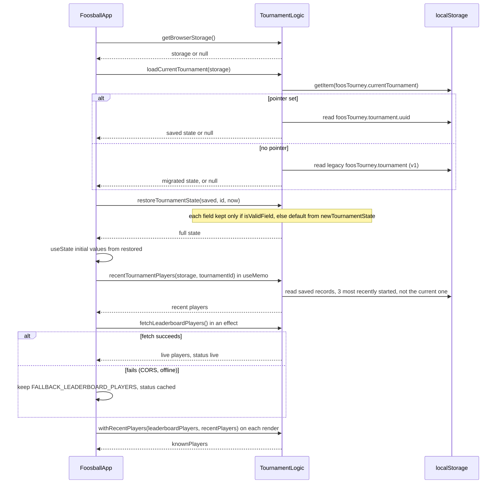

`migrateLegacyTournament` assigns a new UUID, turns `startDate` into a local-midnight
`startedAt`, saves under the new key and removes the legacy key.

## 3. Handler pattern

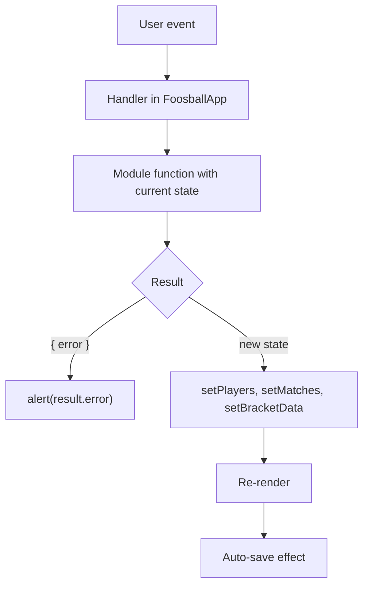

Exceptions to know about:

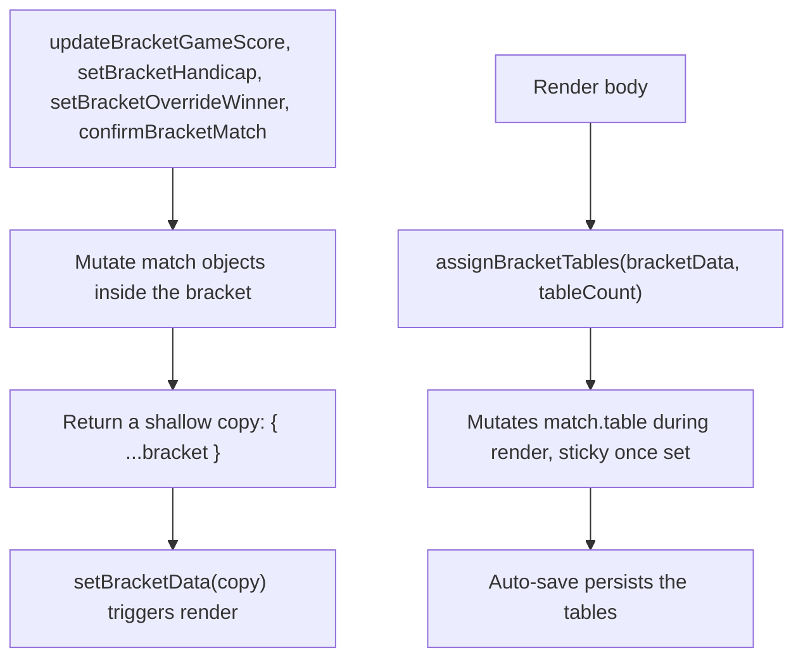

## 4. Matchmaking: `drawFairMatch`

`drawMonsterMatch` finds a table with `findFreeTable`, calls `drawFairMatch`, then builds the match
with `createGameSlots`.

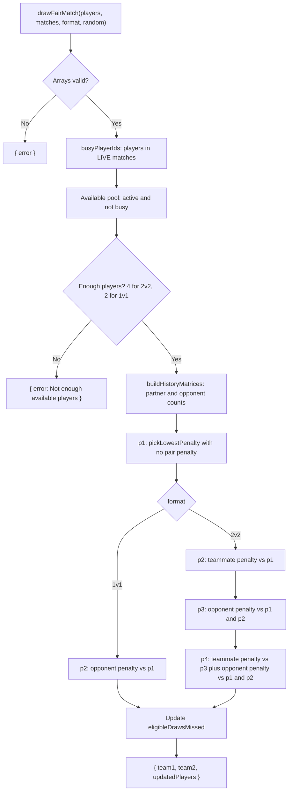

`pickLowestPenalty` scores each candidate:

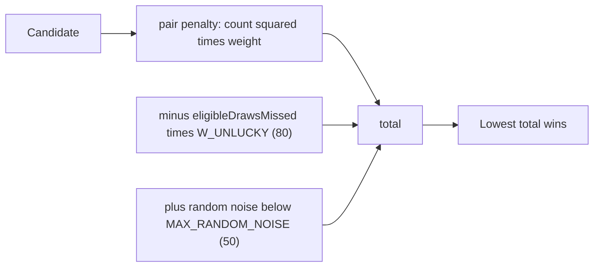

Weights: `W_TEAMMATE` 300, `W_OPPONENT` 100. Drawn players reset `eligibleDrawsMissed` to 0. Active,
idle, undrawn players gain 1.

## 5. Bracket lifecycle

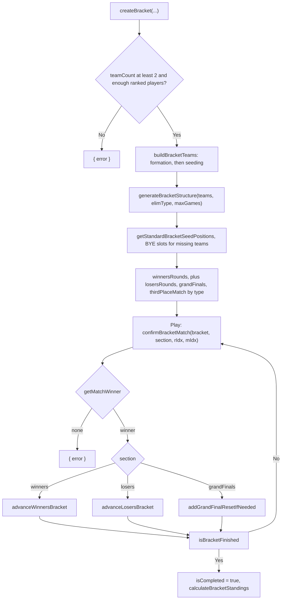

`advanceWinnersBracket` runs three steps:

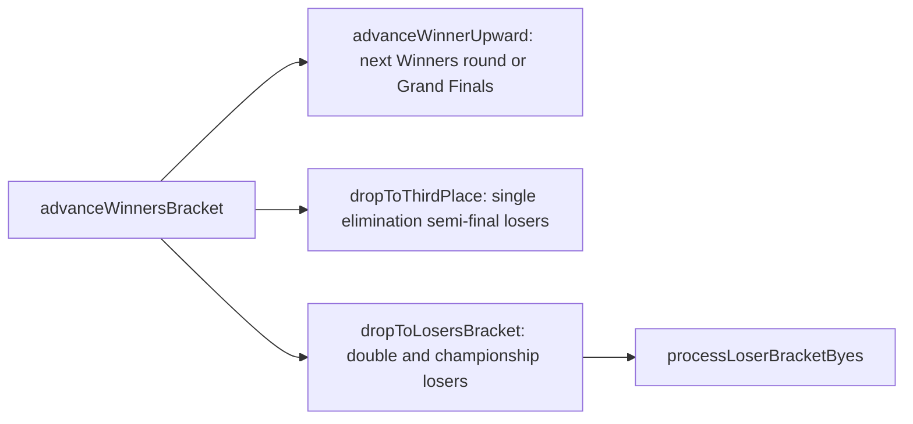

`advanceLosersBracket` calls `advanceLoserWinner`, sends the Losers champion to Grand Finals
(double only), then calls `processLoserBracketByes`. `resetBracket` rebuilds from
`originalTeams` for **Clear Matches**.

## 6. Persistence and import/export

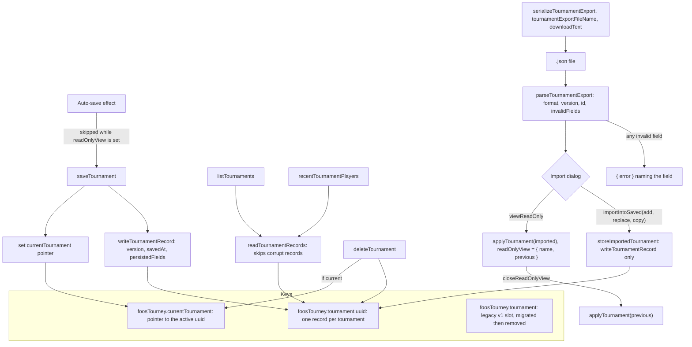

`restoreTournamentState` falls back to the default for an invalid saved field, and loads a tournament
that is locked without a PIN as unlocked. `storeImportedTournament` never changes the current pointer. Replacing the open tournament calls
`applyTournament` so the next auto-save doesn't overwrite the import. `saveTournament` returns
`false` when storage throws, and the footer then shows that saving is off.

## 7. Adding players

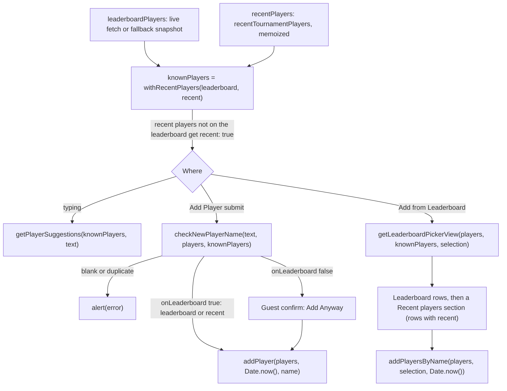

Renames go through `renamePlayer`, which returns `{ error }` for a name another player already has,
so the roster never holds two players with the same name (case-insensitive).

## 8. Display Mode

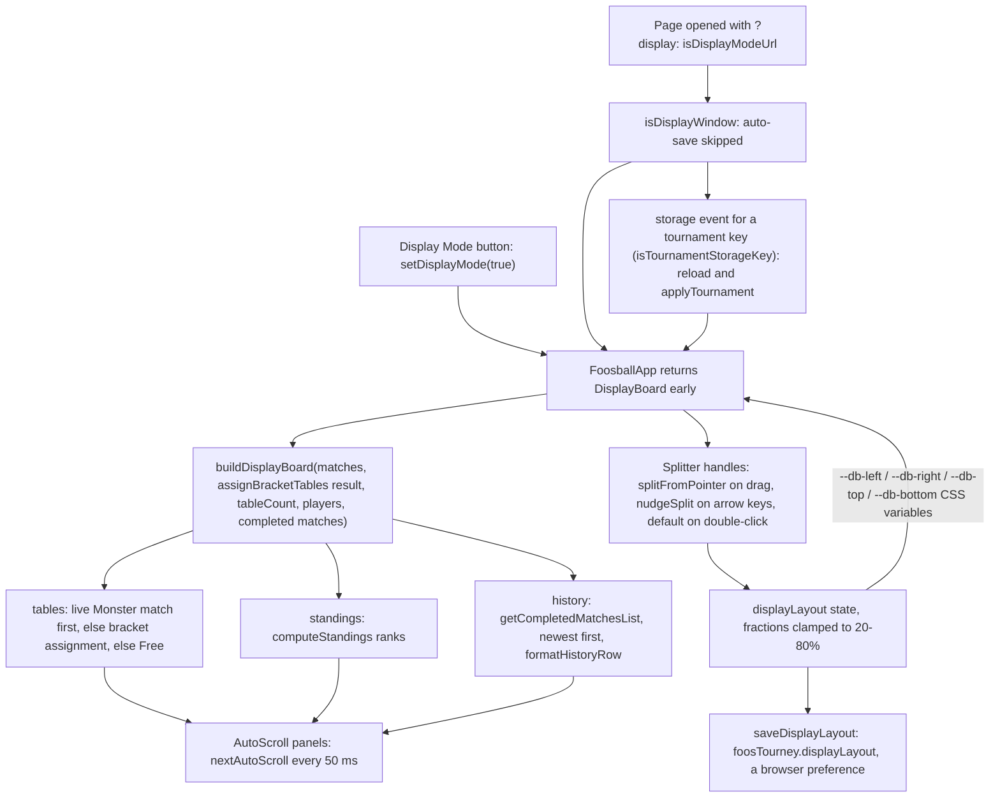

The layout is loaded with `loadDisplayLayout` (invalid values fall back per value). Drag listeners
attach to `window`, so a drag keeps going outside the handle. Portrait screens hide the handles and
stack the panels.

`nextAutoScroll` cycles top pause, scroll, bottom pause, back to top. The step is 0.4% of the panel's
height per tick, so speed scales with the screen. Content that fits never moves, and
`prefers-reduced-motion` disables the timer.

## Module sections and main functions

| Section in `tournament-logic.js` | Main functions                                                                                                                                                                                                                            |
| -------------------------------- | ----------------------------------------------------------------------------------------------------------------------------------------------------------------------------------------------------------------------------------------- |
| Security and sanitization        | `sanitizeInput`, `sanitizeTypedText`, `sanitizeInt`, `normalizeScoreInput`                                                                                                                                                                |
| Admin lock                       | `submitPin`, `forgetPin`                                                                                                                                                                                                                  |
| Tournaments and persistence      | `newTournamentState`, `restoreTournamentState`, `saveTournament`, `loadCurrentTournament`, `listTournaments`, `recentTournamentPlayers`, `withRecentPlayers`, `deleteTournament`                                                          |
| Export and import                | `serializeTournamentExport`, `parseTournamentExport`, `storeImportedTournament`, `getBrowserStorage`                                                                                                                                      |
| Display mode                     | `buildDisplayBoard`, `initialAutoScroll`, `nextAutoScroll`, `isDisplayModeUrl`, `displayModeUrl`, `controlDeskUrl`, `tournamentCsv`, `splitFromPointer`, `nudgeSplit`, `loadDisplayLayout`, `saveDisplayLayout`, `isTournamentStorageKey` |
| Club leaderboard                 | `fetchLeaderboardPlayers`, `getLeaderboardInfo`, `FALLBACK_LEADERBOARD_PLAYERS`                                                                                                                                                           |
| Roster                           | `checkNewPlayerName`, `addPlayer`, `addPlayersByName`, `computeStandings`, `getLeaderboardPickerView`, `getPlayerSuggestions`                                                                                                             |
| Fair matchmaking                 | `drawFairMatch`, `pickLowestPenalty`, `buildHistoryMatrices`                                                                                                                                                                              |
| Monster stage matches            | `drawMonsterMatch`, `findFreeTable`, `completeMonsterMatch`, `getMatchWinner`                                                                                                                                                             |
| Bracket generation               | `createBracket`, `buildBracketTeams`, `generateBracketStructure`, `buildManualTeams`, `clearMatchResults`                                                                                                                                 |
| Bracket play                     | `confirmBracketMatch`, `advanceWinnersBracket`, `advanceLosersBracket`, `isBracketFinished`, `calculateBracketStandings`, `assignBracketTables`                                                                                           |
| History and CSV                  | `getCompletedMatchesList`, `formatHistoryRow`, `buildCsv`, `csvFileName`, `downloadText`, `downloadCsv`                                                                                                                                   |
