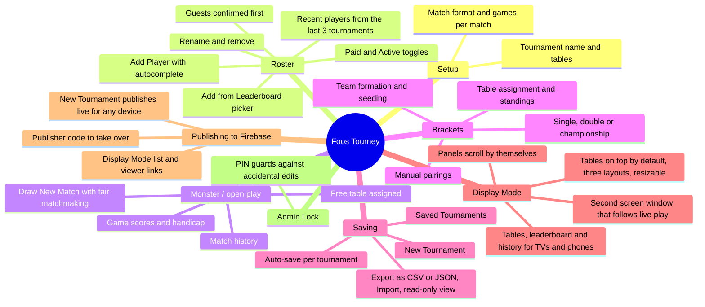
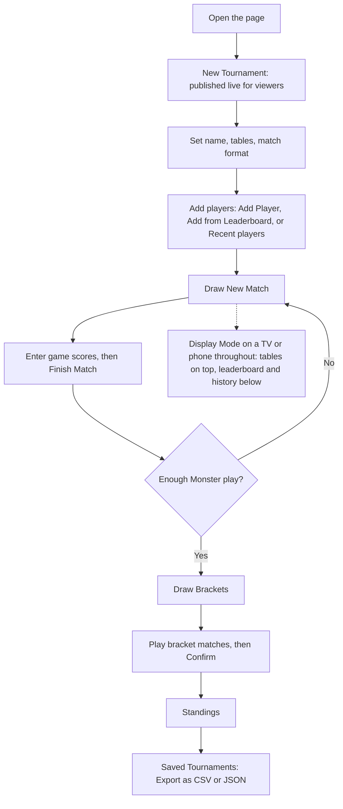
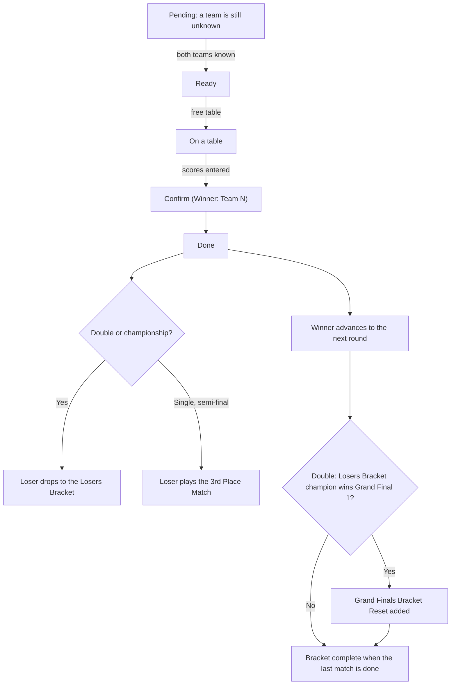
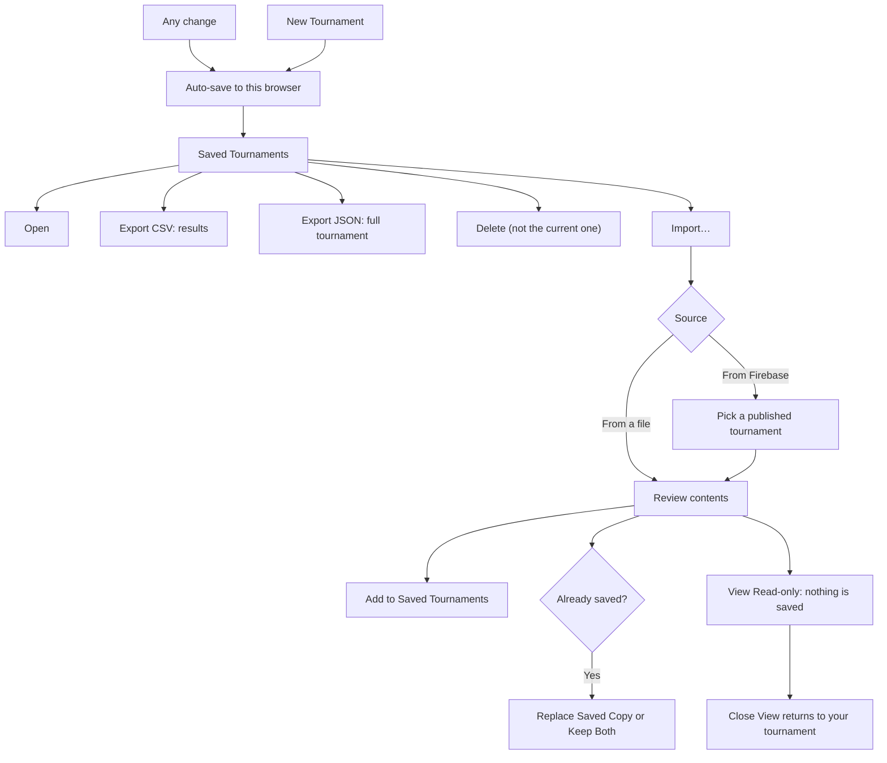
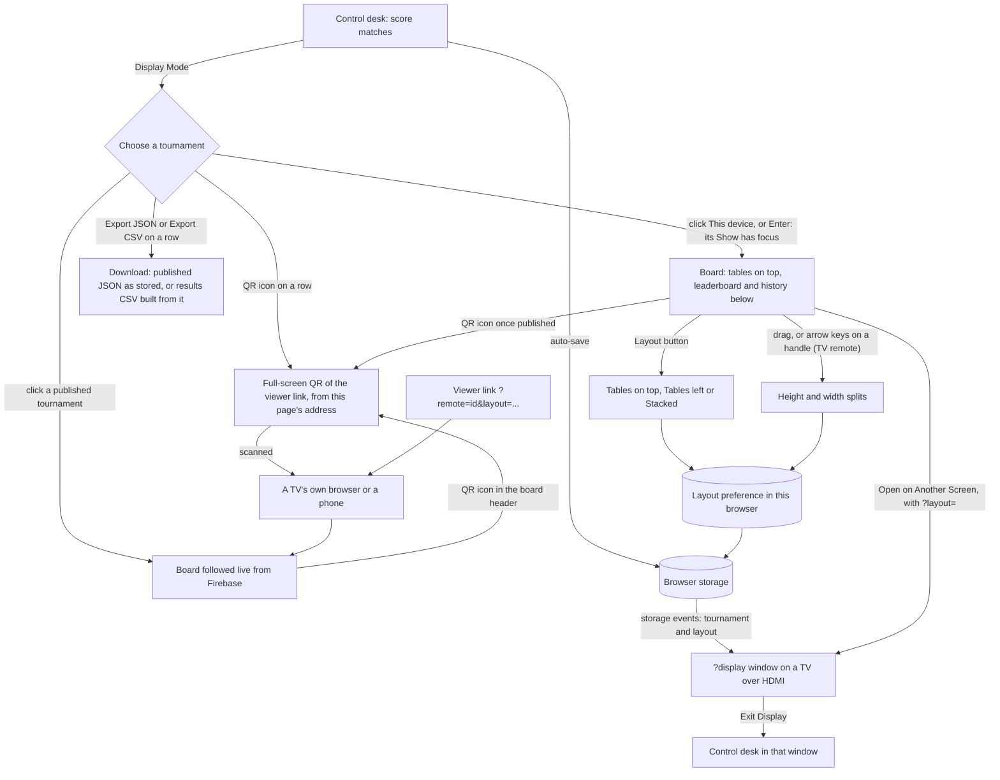
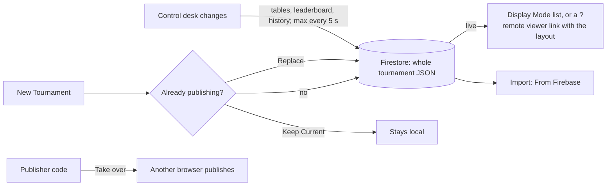
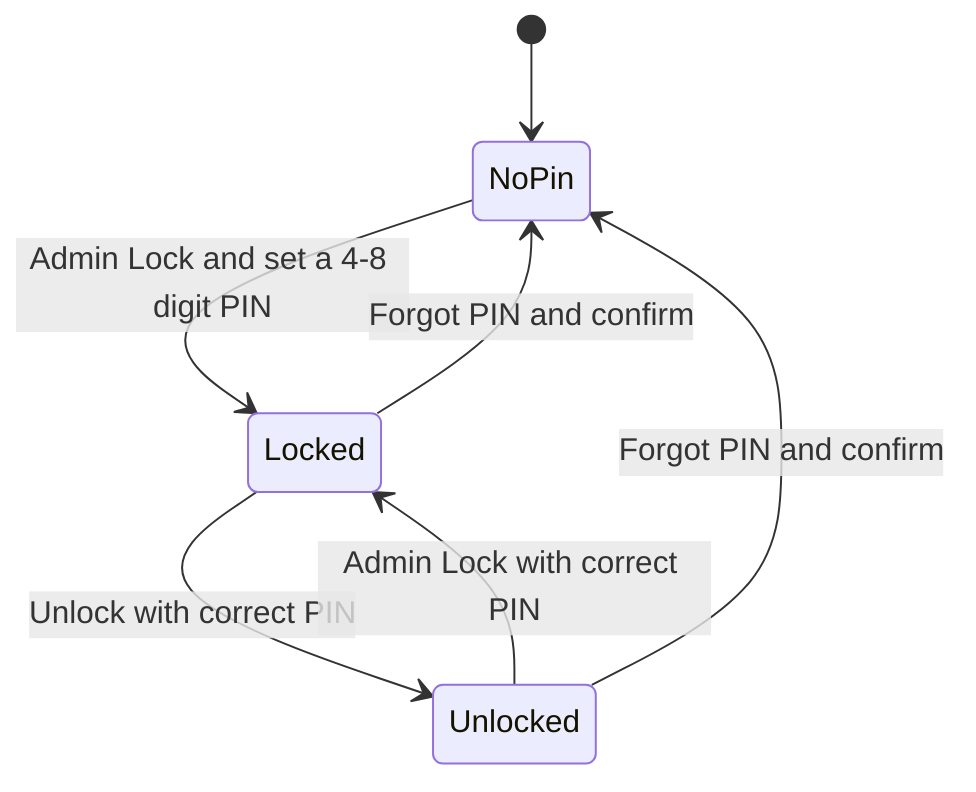

# Foos Tourney

Calgary Foosball Club tournament manager: Monster/DYP open play with fair
matchmaking, then single, double or championship elimination brackets.

## Features at a glance



## Typical tournament night



## Playing a bracket

Each match card moves through these states. Tables are assigned automatically from the **Tables
Available** setting.



## Working with Claude Code

Project conventions for AI-assisted changes (architecture rules, coverage and
build constraints, testing approach, known limitations) are in
[`.claude/CLAUDE.md`](.claude/CLAUDE.md). Read it before changing the code.

## Layout

| File                          | Purpose                                                                           |
| ----------------------------- | --------------------------------------------------------------------------------- |
| `TournamentManager.html`      | The page: React UI, compiled in the browser by Babel. Ships as `dist/index.html`. |
| `tournament-logic.js`         | All tournament behaviour as plain functions (`window.TournamentLogic`).           |
| `firebase-remote.js`          | Thin Firestore adapter for publishing (`window.FirebaseRemote`).                  |
| `firebase-config.js`          | The `foos-tourney` Firebase web config (public). `null` turns publishing off.     |
| `firestore.rules`             | Firestore security rules: the only server-side protection.                        |
| `firebase.json`               | Rules file and emulator ports (8181, 9199) for `firebase-tools`.                  |
| `.firebaserc`                 | Makes `foos-tourney` the default project for `firebase-tools`.                    |
| `eslint.compat.config.js`     | Cross-browser rules: target-browser APIs and secure-page-only APIs.               |
| `docs/firebase-plan.md`       | The publishing design, decisions and risks.                                       |
| `test/`                       | `node:test` unit tests for every function in `tournament-logic.js`.               |
| `test-e2e/`                   | UI tests: drive the real page in headless Chrome.                                 |
| `test-firebase/`              | Rules and adapter tests against the Firestore and Auth emulators.                 |
| `scripts/build.js`            | Quality gates, then copies the app to `dist/` unchanged.                          |
| `scripts/check-css-compat.js` | Cross-browser check for the page's CSS.                                           |

Deploy by serving the contents of `dist/` (`index.html`, the page, plus `tournament-logic.js`,
`firebase-config.js` and `firebase-remote.js`) from one directory, e.g. `calgaryfoosballclub.com/dyp/`.
The live leaderboard fetch only works same-origin with calgaryfoosballclub.com; elsewhere the page
falls back to a bundled snapshot.

To try it on phones and TVs on the same Wi-Fi, serve `dist/` from a laptop:

```sh
npm run build                                      # or: npm run build -- --skip-e2e --skip-firebase (about a minute)
npx http-server@14.1.1 dist -a 0.0.0.0 -p 8080 -c-1   # then open http://<laptop-ip>:8080/
```

A plain-http address like `http://192.168.0.22:8080` isn't a secure page, so browsers leave out the
clipboard there: **Copy** buttons say copying failed (select the text instead). Everything else works.
Hosting on HTTPS (the club site) has neither limit. Keep port 8080 for this: the Firebase emulators use
8181 and 9199.

## Development

Requires Node 20+. The Firestore step also needs Java 21+ (for the emulator); `firebase-tools` runs
through `npx` at a pinned version, so it isn't a dependency.

```sh
npm install
npm test            # unit tests
npm run test:e2e    # UI tests in headless Chrome (needs Chrome + network for the CDN scripts)
npm run coverage:ui # after test:e2e: which UI functions never ran
npm run coverage    # unit tests + 100% coverage gate (HTML report in coverage/)
npm run check:browsers # cross-browser check: JS APIs, secure-page-only APIs, CSS
npm run test:firebase # rules + adapter tests on the emulators, 100% adapter coverage (needs Java)
npm run check       # every quality gate, no dist/
npm run build       # every quality gate, then dist/
npm run format      # apply Prettier to JS/JSON/Markdown
```

`npm run build` stops at the first failing step:

1. ESLint, zero warnings, covering the JS files and the inline JSX in the HTML
2. Prettier format check
3. html-validate
4. Module contract: every name the page imports from `TournamentLogic` exists
5. Cross-browser check (`npm run check:browsers`): browser APIs and CSS the targets in `package.json`
   `browserslist` don't support, and APIs that only exist on secure pages (HTTPS or localhost), such as
   `crypto.randomUUID`, which are missing when the page is opened from a plain-http LAN address. Each
   finding is a build failure
6. Unit tests with 100% statement, branch, function and line coverage
7. UI tests in headless Chrome, covering every control at desktop, tablet and phone widths
8. UI coverage: every function in the page's UI script (components, handlers, inline callbacks)
   must run in at least one UI test
9. Firestore rules and the adapter on the local emulators, with 100% coverage of `firebase-remote.js`
   (`--skip-firebase` where Java isn't available)
10. `npm audit` at high severity (`--skip-audit` when offline)
11. Copy the four app files to `dist/` byte-for-byte, `TournamentManager.html` as `index.html`, with a
    `manifest.json` giving each file's source and SHA-256

The JavaScript is never transpiled, bundled or minified.

Chrome is found via `CHROME_PATH` or the usual install paths. The CI image (`ubuntu-24.04`) has it, and CI
installs Java 21 for the emulators. Steps 7 and 8 are skipped with `--skip-e2e` where Chrome or the
network is unavailable.

UI coverage is measured with Chrome's own V8 coverage of the compiled page script, merged across every
page load in the UI suite (`scripts/ui-coverage.js`). Babel's injected helpers are excluded.

## Tournaments and saving

- Each tournament is identified by a UUID, not a date, so an event that runs past midnight stays one
  tournament. Its date (for exports and the CSV file name) is the local day it started.
- Every tournament auto-saves to its own record in this browser's `localStorage`
  (`foosTourney.tournament.<uuid>`) after each change, and the current one resumes on reload.
- **Recent players:** people from your previous 3 tournaments (by start time) who aren't on the club
  leaderboard, such as guests, appear in a "Recent players" section of **Add from Leaderboard** and in
  name suggestions. Typing one adds them directly, without the guest prompt.
- **New Tournament** starts a fresh event, keeps the previous one, and publishes the new one (see
  [Publishing](#publishing-firebase)). **Saved Tournaments** lists past
  events to reopen or delete. The current tournament can't be deleted. The list is ordered by start time, newest first,
  and opening a tournament doesn't change the order.
- CSV match IDs are prefixed with the tournament UUID, so exports never collide across events.

## Exporting and importing tournaments

- Every row in **Saved Tournaments** has two export buttons for that tournament:
  - **Export CSV**: match results, one row per scored game, for spreadsheets.
  - **Export JSON**: the full tournament (roster, matches, bracket, settings) for importing:
    `{ format: "foos-tourney", version: 1, exportedAt, tournament }`.
- While the admin lock is on, Saved Tournaments still opens so results can be exported. Open, Delete,
  Import and New Tournament stay disabled.
- **Import…** in Saved Tournaments loads an export **from a file** and shows what it contains, then:
  - **Add to Saved Tournaments** adds it without switching to it. If the same tournament is already
    saved, choose **Replace Saved Copy** or **Keep Both** (the copy gets a new id and "(copy)" in its
    name).
  - **View Read-only** shows it with editing disabled and saves nothing. **Close View** (or a reload)
    returns to your own tournament.
- Imported files are validated field by field like saved data. Other JSON files and exports from a
  newer version are rejected with a message.
- **From Firebase** lists the tournaments published from other devices and hands the chosen one to the
  same review, so it can be added or viewed read-only (see [Publishing](#publishing-firebase)).
- Private browsing or blocked site data disables auto-save, and the footer says so.
- Saves from before tournaments had ids are migrated automatically on first load.



## Display Mode

**📺 Display Mode** (upper right, or the phone menu) shows a view-only board for TVs and phones:

- **Tables:** every table, who is on it, the stage (Monster match or bracket match label), games won
  and the current game scores. Free tables say so.
- **Leaderboard:** the Monster standings.
- **Match history:** most recent first.

Panels scroll by themselves when their content doesn't fit, pausing at the top and bottom. Devices set
to reduce motion scroll manually instead. All sizes are relative to the screen. It works while locked
and in the read-only view.

On wide screens (TVs, laptops) the default layout puts the tables on top, with the leaderboard and
match history side by side underneath. **Layout** in the board's header switches between:

- **Tables on top** (default): leaderboard and history side by side below.
- **Tables left**: leaderboard above history on the right.
- **Stacked**: tables, leaderboard and history in full-width rows.

Every layout has two handles: one between the tables and the rest, and one between the leaderboard and
match history. Drag them with a mouse, or focus one and use the arrow keys (5% steps), which also works
with a TV remote. A double-click resets a handle. No area goes below 20%.

Phones always show tables, then the leaderboard, then match history, without handles or the Layout
button.

The layout is remembered in this browser. A second-screen window on the same computer (a TV over HDMI)
follows layout changes made on the laptop straight away. **Open on Another Screen** and the publishing
viewer link carry the current layout (`?layout=top-50-50`), so a TV's own browser opens already
arranged.

**Open on Another Screen** opens the board in a new window (`?display=1`) that
can be moved to a TV. It updates as you score on the control desk and never saves anything. Without
publishing it only follows tournaments on the same computer. **Exit Display** returns to the control desk.

When publishing is set up, Display Mode and second-screen windows first show a list: **This device**
first, then the tournaments published from any device, which are followed live. One click on a row
shows it. Each row also has **Show**, **Export JSON** and **Export CSV**, which download that tournament
without showing it. For this device they make the same files as Saved Tournaments. For a published
tournament they fetch it from Firebase at that moment: **Export JSON** saves the published JSON exactly as
Firebase holds it, and **Export CSV** builds the match results from that same JSON. Focus starts on this device's **Show**, so
Enter or a TV remote's OK puts the local board up straight away. **Switch tournament** returns to the
list. A viewer link
(`?remote=<id>`) opens straight to a published tournament on any phone or TV.

The **QR code** button (a QR icon, on each row of the list and in the board's header just left of
**Layout**) shows a full-screen QR code for that tournament's viewer link, so people can scan it with a
phone and land straight in Display Mode. The tournament's name and start time sit above the code, and the
full link in small type below. The code takes 80% of the screen's smaller side, so it fits any TV, laptop
or phone. **Close**, Escape (a TV remote's Back) or a click outside the code closes it.

- The link is built from the address the page is open at, so it works wherever the page is hosted. If that
  address is only reachable from this computer (`localhost`, `127.0.0.1`), the dialog warns that phones
  can't follow it: open the page at the network address or the club site instead.
- The button only appears when there is a code to show. This device's tournament gets one once it is
  published (New Tournament), since other phones can't read this browser; without publishing set up,
  there is no button.
- The icon is Lucide's `qr-code` (ISC licence), inlined in the page with its licence notice.
- Codes are drawn with [qrcode-generator](https://github.com/kazuhikoarase/qrcode-generator) (MIT),
  loaded from jsDelivr at a pinned version with an integrity hash. If it can't load, the dialog still shows
  the link.



## Publishing (Firebase)

Publishing lets anyone follow a tournament live from any device, and import it, without accounts. It
uses the club's `foos-tourney` Firebase project (free Spark plan). Setting `firebase-config.js` back to
`null` turns it off. The design and its reasoning are in the
[Firebase publishing plan](docs/firebase-plan.md).

- **New Tournament** publishes the new tournament at once. The tournament a first visit creates on
  its own stays local.
- Only changes Display Mode shows (tables, leaderboard, match history) are sent, at most every 5
  seconds. Each write carries the whole tournament, so other edits (such as paid flags) ride along.
  The PIN and lock are never published.
- **5 slots** in total, **one per browser**. A browser already publishing is asked **Replace** or
  **Keep Current**. A slot frees 24 hours after its last published change. When all are in use the
  tournament runs normally and the page says when the next slot frees.
- **📡 Publishing** (under Saved Tournaments) shows the slot, the viewer link and the **publisher
  code**, with **Copy** and **Save Code to File** (`*.publisher-code.txt`, git-ignored). Another
  browser can **Take Over Publishing** with the code or the file. The old browser then shows
  "Publishing moved to another device".
- Everything published is readable by anyone, including names, results and paid flags.

Setting up a project (already done for `foos-tourney`):

1. Create a Firebase project, enable Firestore and **Anonymous** sign-in, and register a web app.
2. Paste the web app's config into `firebase-config.js` (it is meant to be public).
3. `npx firebase-tools@15.32.1 deploy --only firestore:rules --project <project-id>`.



## Admin lock

- Each tournament has its own lock. The first **Admin Lock** asks for a 4-8 digit PIN. The lock prevents accidental edits on a shared
  screen. It isn't security: **Forgot PIN?** unlocks after a confirm.



## Club leaderboard

The page fetches `calgaryfoosballclub.com/leaderboard/` live. Browsers only allow that when the page
is served from the same site (CORS), so hosting anywhere else, or opening the file locally, uses the
bundled snapshot. The UI shows the snapshot's date. To update it:

```sh
npm run refresh-leaderboard   # fetches from Node (no CORS), rewrites the snapshot
git diff tournament-logic.js  # review, then npm run build
```

To get live data on another host, the club site must send an `Access-Control-Allow-Origin` header for
that host on `/leaderboard/`.

## Known issues

Open bugs and gaps are tracked as [GitHub issues](https://github.com/DT209/foos-tourney/issues) for
discussion and resolution.
