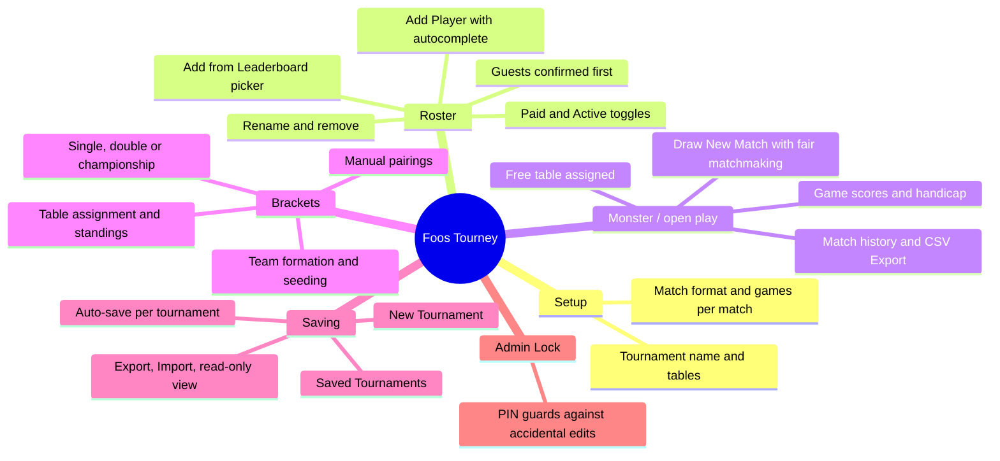
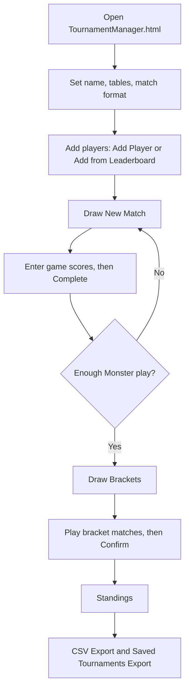
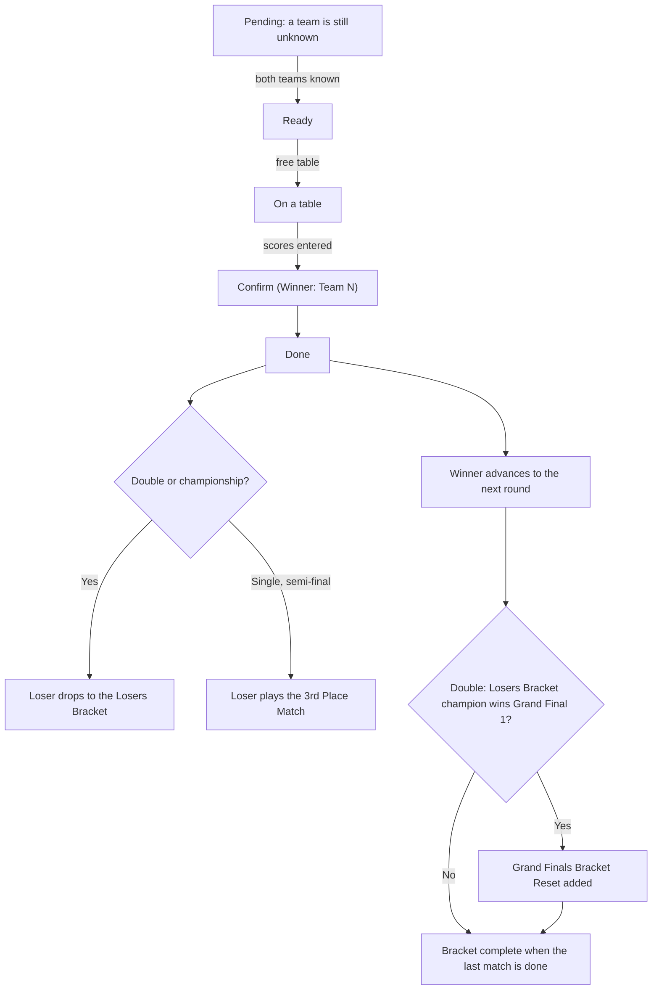
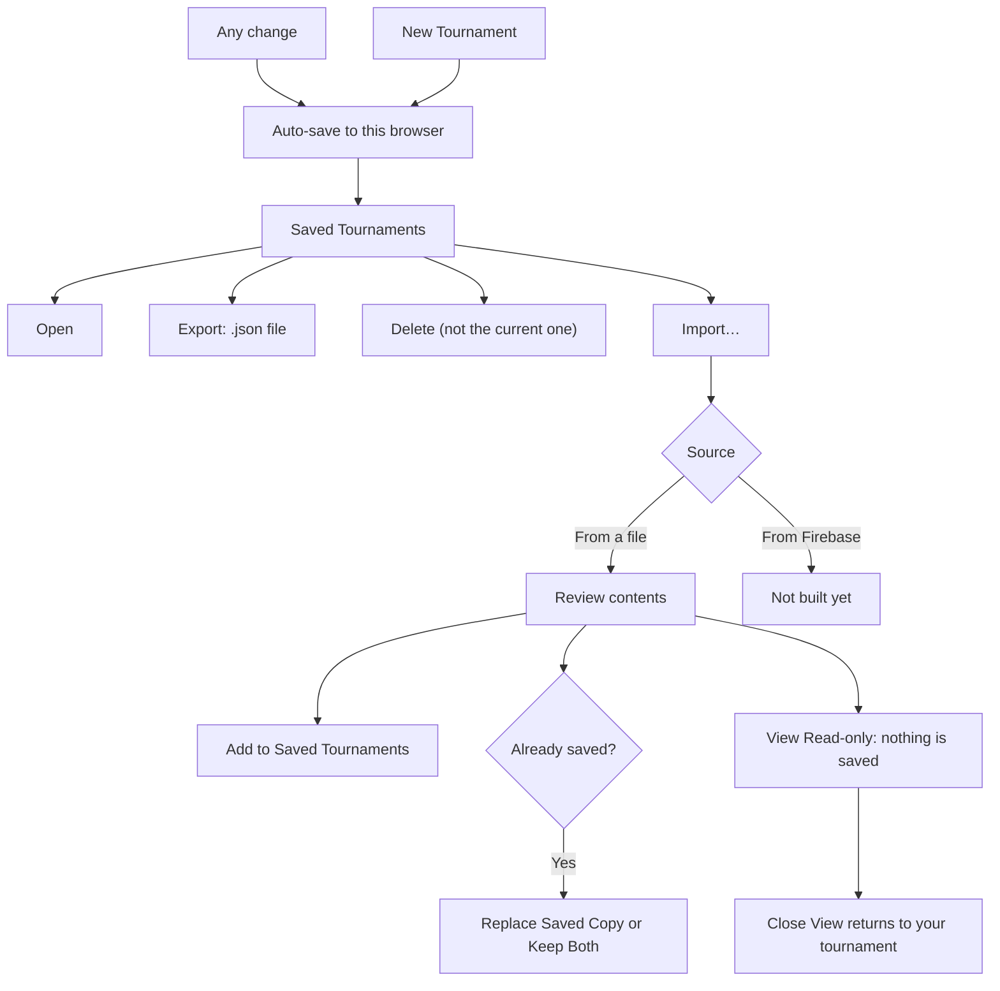
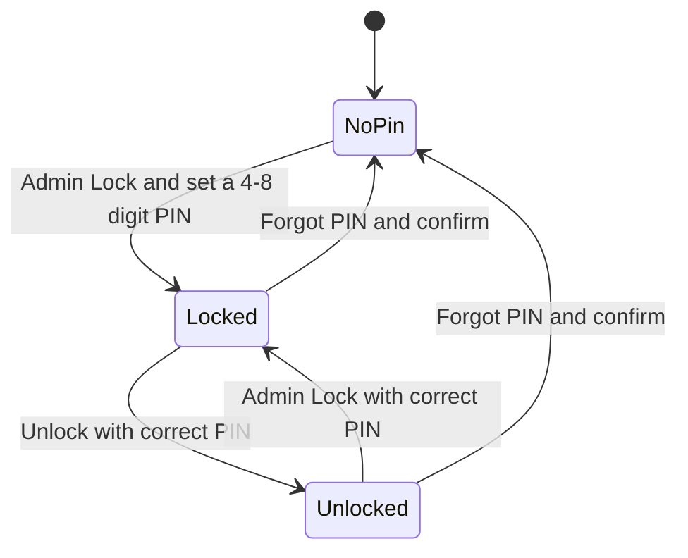

# Foos Tourney

Calgary Foosball Club tournament manager: Monster/DYP open play with fair
matchmaking, then single, double or championship elimination brackets.

## Features at a glance



## Typical tournament night



## Playing a bracket

Each match card moves through these states. Tables are assigned automatically from the **Tables
Available** setting.



## Working with Claude Code

Project conventions for AI-assisted changes (architecture rules, coverage and
build constraints, testing approach, known limitations) are in
[`.claude/CLAUDE.md`](.claude/CLAUDE.md). Read it before changing the code.

## Layout

| File                     | Purpose                                                                 |
| ------------------------ | ----------------------------------------------------------------------- |
| `TournamentManager.html` | The page: React UI, compiled in the browser by Babel. No build step.    |
| `tournament-logic.js`    | All tournament behaviour as plain functions (`window.TournamentLogic`). |
| `test/`                  | `node:test` unit tests for every function in `tournament-logic.js`.     |
| `test-e2e/`              | UI tests: drive the real page in headless Chrome.                       |
| `scripts/build.js`       | Quality gates, then copies the app to `dist/` unchanged.                |

Deploy by serving `TournamentManager.html` and `tournament-logic.js` from the
same directory (e.g. `calgaryfoosballclub.com/dyp/`). The live leaderboard
fetch only works same-origin with calgaryfoosballclub.com; elsewhere the page
falls back to a bundled snapshot.

## Development

Requires Node 20+.

```sh
npm install
npm test            # unit tests
npm run test:e2e    # UI tests in headless Chrome (needs Chrome + network for the CDN scripts)
npm run coverage:ui # after test:e2e: which UI functions never ran
npm run coverage    # unit tests + 100% coverage gate (HTML report in coverage/)
npm run check       # every quality gate, no dist/
npm run build       # every quality gate, then dist/
npm run format      # apply Prettier to JS/JSON/Markdown
```

`npm run build` stops at the first failing step:

1. ESLint, zero warnings, covering the JS files and the inline JSX in the HTML
2. Prettier format check
3. html-validate
4. Module contract: every name the page imports from `TournamentLogic` exists
5. Unit tests with 100% statement, branch, function and line coverage
6. UI tests in headless Chrome, covering every control at desktop, tablet and phone widths
7. UI coverage: every function in the page's UI script (components, handlers, inline callbacks)
   must run in at least one UI test
8. `npm audit` at high severity (`--skip-audit` when offline)
9. Copy `TournamentManager.html` and `tournament-logic.js` to `dist/` byte-for-byte, with a SHA-256 `manifest.json`

The JavaScript is never transpiled, bundled or minified.

Chrome is found via `CHROME_PATH` or the usual install paths. GitHub Actions' `ubuntu-latest` has it.
Steps 6 and 7 are skipped with `--skip-e2e` where Chrome or the network is unavailable.

UI coverage is measured with Chrome's own V8 coverage of the compiled page script, merged across every
page load in the UI suite (`scripts/ui-coverage.js`). Babel's injected helpers are excluded.

## Tournaments and saving

- Each tournament is identified by a UUID, not a date, so an event that runs past midnight stays one
  tournament. Its date (for exports and the CSV file name) is the local day it started.
- Every tournament auto-saves to its own record in this browser's `localStorage`
  (`foosTourney.tournament.<uuid>`) after each change, and the current one resumes on reload.
- **New Tournament** starts a fresh event and keeps the previous one. **Saved Tournaments** lists past
  events to reopen or delete. The current tournament can't be deleted.
- CSV match IDs are prefixed with the tournament UUID, so exports never collide across events.

## Exporting and importing tournaments

- **Export** on any row in **Saved Tournaments** downloads that tournament (roster, matches, bracket,
  settings) as a `.json` file: `{ format: "foos-tourney", version: 1, exportedAt, tournament }`.
- **Import…** in Saved Tournaments loads an export **from a file** and shows what it contains, then:
  - **Add to Saved Tournaments** adds it without switching to it. If the same tournament is already
    saved, choose **Replace Saved Copy** or **Keep Both** (the copy gets a new id and "(copy)" in its
    name).
  - **View Read-only** shows it with editing disabled and saves nothing. **Close View** (or a reload)
    returns to your own tournament.
- Imported files are validated field by field like saved data. Other JSON files and exports from a
  newer version are rejected with a message.
- **From Firebase** is listed as an import source but not built yet.
- Private browsing or blocked site data disables auto-save, and the footer says so.
- Saves from before tournaments had ids are migrated automatically on first load.



## Admin lock

- Each tournament has its own lock. The first **Admin Lock** asks for a 4-8 digit PIN. The lock prevents accidental edits on a shared
  screen. It isn't security: **Forgot PIN?** unlocks after a confirm.



## Club leaderboard

The page fetches `calgaryfoosballclub.com/leaderboard/` live. Browsers only allow that when the page
is served from the same site (CORS), so hosting anywhere else, or opening the file locally, uses the
bundled snapshot. The UI shows the snapshot's date. To update it:

```sh
npm run refresh-leaderboard   # fetches from Node (no CORS), rewrites the snapshot
git diff tournament-logic.js  # review, then npm run build
```

To get live data on another host, the club site must send an `Access-Control-Allow-Origin` header for
that host on `/leaderboard/`.

## Known issues

Open bugs and gaps are tracked as [GitHub issues](https://github.com/DT209/foos-tourney/issues) for
discussion and resolution.
