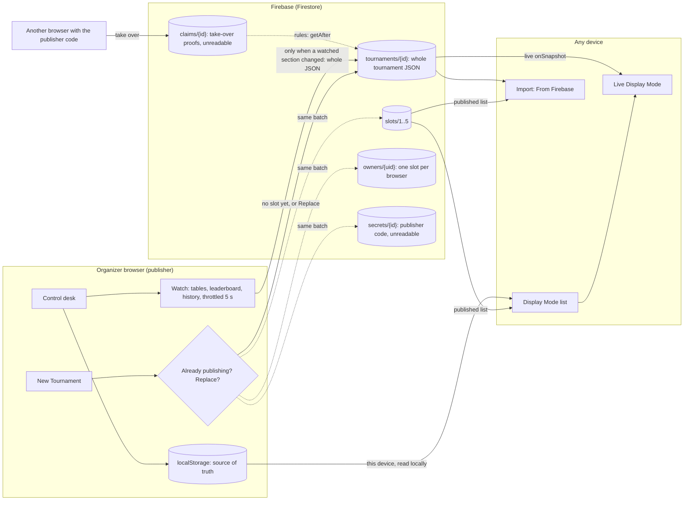
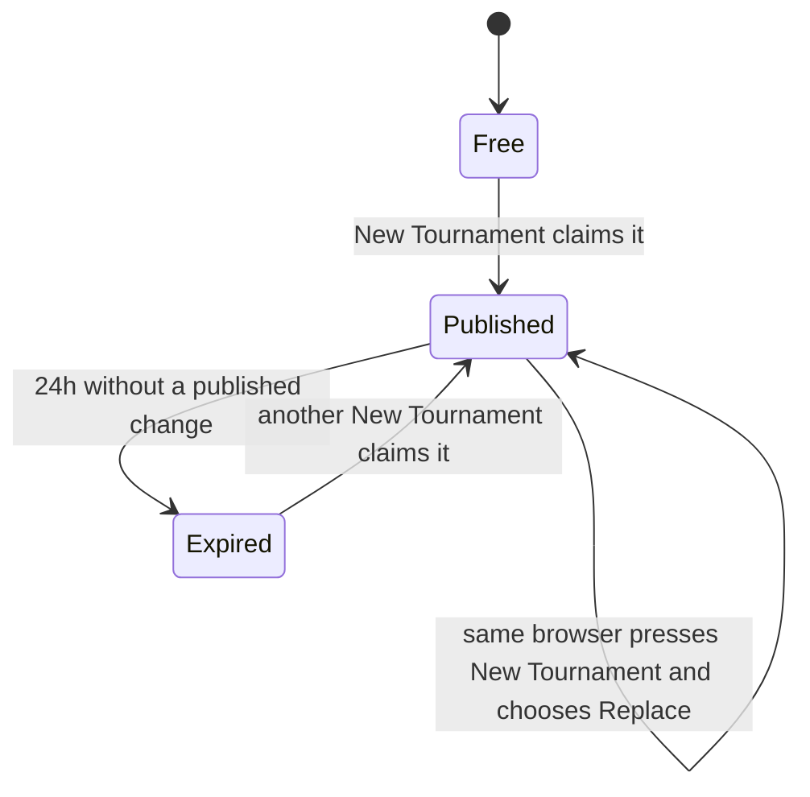

# Firebase publishing plan

Status: proposal, not built. The import dialog already lists **From Firebase** as "coming soon".

## Goal

When an organizer presses **New Tournament**, the new tournament is published to Firebase
automatically, without sign-up, so that:

- anyone can pick it in **Display Mode** on any device (TVs, players' phones) and watch it live, and
- anyone can bring it into their own browser through **Import… → From Firebase**, using the existing
  review dialog (Add, Replace, Keep Both, View Read-only).

Firebase holds the whole tournament as JSON, shared with every listener. It is only written when the
tournament starts and when the parts viewers see change: **table status, the leaderboard and match
history**. `localStorage` stays the source of truth.

## Assumptions (agreed)

| Topic          | Decision                                                                                                                                                    |
| -------------- | ----------------------------------------------------------------------------------------------------------------------------------------------------------- |
| When it starts | Pressing **New Tournament** publishes the new tournament at once. A tournament the page creates on its own (a browser's first visit) stays local.           |
| What is sent   | The whole tournament as JSON (the **Export JSON** envelope), including paid flags. Only the admin PIN and lock are left out: they belong to one device.     |
| When it's sent | At the start, then only when table status, the leaderboard or match history change, at most once every 5 seconds. Other edits ride along in the next write. |
| Who can read   | Anyone. Every listener gets the same document.                                                                                                              |
| Identity       | Firebase **Anonymous Authentication**: each browser gets a silent `uid`, with no login screen or account.                                                   |
| Publisher      | The browser that starts the tournament owns it (`ownerUid`). Only the owner can change it.                                                                  |
| Capacity       | **5 slots** in total, and **one slot per browser**. If the browser already publishes a tournament, New Tournament asks whether to replace it.               |
| Expiry         | A slot expires **24 hours after the publisher's last published change**. Anyone can then claim it, which removes the old tournament.                        |
| Abuse controls | **No CAPTCHA / App Check.**                                                                                                                                 |
| Hand-over      | A **publisher code** lets another browser take over publishing.                                                                                             |
| Display Mode   | Opens with a list to pick from: this device's tournament (read locally) and the published tournaments (read from Firebase).                                 |
| Plan           | Firebase free (Spark) plan. No Cloud Functions, so everything is enforced by security rules.                                                                |
| Future         | Google sign-in, linked to the anonymous account (see [Future: Google sign-in](#future-google-sign-in)).                                                     |

## Everything sent to Firebase

This is the complete list of writes. Anything not here is not sent.

| When                                                                          | What is written                                                                                                                                            |
| ----------------------------------------------------------------------------- | ---------------------------------------------------------------------------------------------------------------------------------------------------------- |
| **New Tournament**, browser has no slot                                       | Anonymous sign-in (Firebase Auth, no data), then one batch: the tournament JSON, the slot claim, the browser's slot record, and the publisher code secret. |
| **New Tournament**, browser already publishes one, organizer says **Replace** | One batch: the new tournament JSON in the same slot, its publisher code secret, and removal of the old tournament's documents.                             |
| **New Tournament**, organizer says **Keep current**                           | Nothing. The new tournament stays local and the old one keeps publishing.                                                                                  |
| **A watched section changes** (throttled to 5 s)                              | One update replacing the tournament JSON, with a server timestamp.                                                                                         |
| **Take over publishing** (someone enters the code)                            | One batch: the take-over proof and the new owner. If that browser already holds a slot and agrees to give it up, the batch also frees it.                  |

Reads (the Display Mode list, live views, imports) are subscriptions or fetches, not writes.

The watched sections are exactly what Display Mode shows, compared with what was last sent:

| Section       | Changes when                                                                                   |
| ------------- | ---------------------------------------------------------------------------------------------- |
| Table status  | A match is drawn, finished or deleted, a bracket match gets a table, or a game score is typed. |
| Leaderboard   | A result changes the standings, or a player is added, renamed, removed, paused or unpaused.    |
| Match history | A match is completed, or results are cleared.                                                  |

Edits that don't change those sections (paid flags, settings, bracket options, the lock, saving,
importing or exporting) send nothing on their own. Because each write carries the whole tournament,
they reach Firebase with the next write a watched change triggers. There is no "unpublish" message: a
tournament stops changing and its slot frees 24 hours after its last change, or when the same browser
replaces it.

## Architecture



## Data model (Firestore)

| Path               | Readable by | Fields                                                                                                                                         |
| ------------------ | ----------- | ---------------------------------------------------------------------------------------------------------------------------------------------- |
| `tournaments/{id}` | anyone      | `ownerUid`, `slot` (1-5), `updatedAt` (server time), `name`, `startedAt`, `export`: the **Export JSON** envelope (format, version, tournament) |
| `slots/{1..5}`     | anyone      | `tournamentId`, `ownerUid`. Written only when claimed, replaced or taken over. A missing document means the slot is free.                      |
| `owners/{uid}`     | anyone      | `slot`, `tournamentId`: the one slot this browser publishes in.                                                                                |
| `secrets/{id}`     | **nobody**  | `code`: the publisher code. Rules can still read it with `get()`.                                                                              |
| `claims/{id}`      | **nobody**  | `uid`, `code`: written by a browser taking over, checked by rules.                                                                             |

- `{id}` is the tournament's existing UUID (`tournamentId`).
- `export` reuses `serializeTournamentExport` and `parseTournamentExport`, so a published tournament
  gets the same deep validation as a file, and imports through the same dialog. The published copy has
  `adminPin: null` and `isLocked: false`. Paid flags are included.
- Tournaments are far below Firestore's 1 MiB document limit.
- `updatedAt` is always the server's `request.time`. Expiry is read from the tournament document, so a
  routine update touches only that one document.
- An `owners/{uid}` record is **stale** once its slot belongs to someone else (the slot expired and was
  claimed). A stale record doesn't count against the browser.

## Security rules (outline)

```
function tournamentOf(slot) { return get(/databases/$(database)/documents/tournaments/$(slot.data.tournamentId)); }
function expired(slot) { return tournamentOf(slot).data.updatedAt < request.time - duration.value(24, 'h'); }
function holdsSlot(uid) {
  return exists(/databases/$(database)/documents/owners/$(uid))
    && get(/databases/$(database)/documents/slots/$(get(/databases/$(database)/documents/owners/$(uid)).data.slot)).data.ownerUid == uid;
}
```

| Action                                | Allowed when                                                                                                                                                                                                                                                                                                                                                                                                                       |
| ------------------------------------- | ---------------------------------------------------------------------------------------------------------------------------------------------------------------------------------------------------------------------------------------------------------------------------------------------------------------------------------------------------------------------------------------------------------------------------------- |
| Read `tournaments`, `slots`, `owners` | Always.                                                                                                                                                                                                                                                                                                                                                                                                                            |
| Read `secrets`, `claims`              | Never.                                                                                                                                                                                                                                                                                                                                                                                                                             |
| **Start publishing**                  | Signed in; `!holdsSlot(uid)`; slot `n` is free or `expired`; in one batch the slot gets `{ tournamentId: id, ownerUid: uid }`, `owners/{uid}` is set to `{ slot: n, tournamentId: id }`, `tournaments/{id}` is created with `ownerUid = uid`, `slot = n`, `updatedAt = request.time`, and `secrets/{id}` is created (checked with `getAfter`). The batch may delete the expired tournament, secret and claim of the slot it takes. |
| **Replace** (same browser)            | Signed in; `owners/{uid}` points at slot `n` and the slot is still owned by `uid`; one batch deletes the old tournament, secret and claim, creates the new tournament and secret, and points the slot and `owners/{uid}` at the new id.                                                                                                                                                                                            |
| **Publish a change**                  | Signed in as the tournament's `ownerUid`; only `export`, `name` and `updatedAt` change; `updatedAt == request.time`; the slot still points at this tournament.                                                                                                                                                                                                                                                                     |
| **Take over** with the code           | One batch writes `claims/{id}` with `{ uid, code }` where `code == get(secrets/{id}).code`, sets `ownerUid = uid` on the tournament and its slot, and points `owners/{uid}` at it (checked with `getAfter(claims/{id})`). If `holdsSlot(uid)`, the same batch must free that slot.                                                                                                                                                 |
| Shape checks                          | Tournament documents may only contain the listed fields, and `export.tournament.adminPin` must be `null`.                                                                                                                                                                                                                                                                                                                          |
| Anything else                         | Denied.                                                                                                                                                                                                                                                                                                                                                                                                                            |

The publisher code never appears in a readable document. `secrets` and `claims` are unreadable, and
rules read them server-side.

## Publisher code

- Generated in the browser when New Tournament starts publishing: 12 random characters from a
  32-character alphabet without look-alikes (Crockford base32), shown as `XXXX-XXXX-XXXX` (60 bits, so
  guessing is not practical even without a CAPTCHA). Kept in `localStorage` with the tournament. A
  replacement tournament gets a new code.
- Shown with **Copy** and **Save code to file**. The file, `<tournament name>_<date>.publisher-code.txt`
  (saved through `downloadText`), holds the tournament name, its id, the viewer link, the code and a
  one-line note on taking over. Treat it like a password: anyone with it can take over publishing.
- The repo's `.gitignore` excludes `*.publisher-code.txt`, so a code file saved into a working copy can
  never be committed by accident.
- **Take over publishing** on another browser: enter the code, or pick the saved code file. That browser
  imports the published tournament from Firebase (the whole JSON is there) and becomes its publisher. If
  it already publishes a tournament, it first asks "Taking over stops publishing 'Week 3'. Continue?".
  The old browser's next write fails with "Publishing moved to another device". The code stays the same,
  so it can move again later.
- If both the browser and the code are lost, the tournament can't be changed again, but anyone can still
  watch or import it. Its slot frees 24 hours after its last change.

## Slots, replacing and expiry



- **New Tournament with no slot:** the browser picks a free slot, or else the oldest expired one, and
  claims it in a transaction, retrying another slot if it loses a race.
- **New Tournament while already publishing:** "You're already publishing 'Week 3'. Replace it with this
  new tournament?"
  - **Replace:** the new tournament takes over the same slot, with a new publisher code, and the old
    tournament is removed from Firebase. It stays in this browser's Saved Tournaments.
  - **Keep current:** the new tournament stays local, and 'Week 3' keeps publishing.
- **All 5 slots in use** (by other browsers): the tournament runs normally but unpublished, and the
  control desk shows "All 5 publishing slots are in use. The next one frees at 9:40 PM". It tries again at
  the next watched change after that time.
- Reopening a tournament this browser still publishes (from Saved Tournaments) resumes publishing its
  watched changes. Other tournaments it opens or imports are not published.
- Expired tournaments stay readable until their slot is claimed. Listeners then see "This tournament is
  no longer published".

## Display Mode tournament list

Pressing **Display Mode** first shows a list to pick from:

| Entry                     | Source and behaviour                                                                                                                                    |
| ------------------------- | ------------------------------------------------------------------------------------------------------------------------------------------------------- |
| **This device**           | The tournament open on this computer, always first. Read locally and updated as you score, even if it is also published.                                |
| **Published tournaments** | Up to 5, read from Firebase (`slots` and `tournaments`), each with its name, start time and last update. Picking one follows it live with `onSnapshot`. |

- The local tournament is listed once. If it is also published, it shows as **This device** and is
  never read back from Firebase.
- If Firebase can't be reached or isn't configured, the list shows **This device** with a note, and
  picking it works as today.
- The board's header gets **Switch tournament** to return to the list, next to **Open on Another
  Screen** and **Exit Display**.
- **Open on Another Screen** and `?display` windows open straight to this device's tournament, as today.
  `?remote=<id>` links open straight to that published tournament.
- Display Mode stays read-only for every entry. Nothing in it writes to Firebase or `localStorage`.

## Client changes

### `tournament-logic.js` (pure, 100% unit-tested)

- `watchedSections(board)` picks table status, leaderboard and history from `buildDisplayBoard` output.
  `watchedChanged(previous, next)` says whether any of them changed since the last write.
- `publishedTournament(state)`: the Export JSON envelope with `adminPin: null` and `isLocked: false`.
- `publishThrottle(lastSentAt, now, 5000)`: at most one write every 5 seconds, with a trailing write for
  the latest state.
- `publishDecision(ownerRecord, slots, now)`: `claim` (no slot), `ask-replace` (this browser already
  publishes, with that tournament's name) or `full` (all 5 taken, with the next free time).
- `displayChoices(localSummary, published)`: the Display Mode list, local first, with the local
  tournament removed from the published entries.
- `generatePublisherCode(random)`, `formatPublisherCode(code)`, `normalizePublisherCode(input)`,
  `publisherCodeFile(state, code, viewerUrl)` and `parsePublisherCodeFile(text)`.
- `isSlotExpired(updatedAt, now)` and `nextFreeSlot(slots, tournaments, now)` (free first, then the
  oldest expired).
- `remoteTournamentUrl(href, id)` and `isRemoteViewUrl(search)` for `?remote=<id>`.

### `firebase-remote.js` (new, thin adapter, classic script)

Wraps the Firebase SDK behind one small interface: `signIn()`, `ownerRecord()`,
`startPublishing(doc, code)`, `replacePublished(oldId, doc, code)`, `publish(id, doc)`,
`takeOver(id, code, { releaseCurrent })`, `listTournaments()`, `fetchTournament(id)`,
`subscribe(id, onChange)`. UI tests inject a fake with the same interface that records every call, so
tests can assert exactly when something was sent.

### `TournamentManager.html`

- Load the Firebase SDK (compat build) from `gstatic.com` at a pinned version, plus `firebase-config.js`
  (the project's public web config).
- **New Tournament** asks `publishDecision`, shows the replace question when needed, then starts or
  replaces publishing. An effect watches `watchedSections` and, when they change, sends the whole
  tournament through the throttle. A `?display` window, a `?remote` listener, Display Mode and the
  read-only view never publish.
- **Publishing status** on the control desk: "Live" with the viewer link and **Copy**, the slot and
  expiry, the publisher code with **Copy** and **Save code to file**, **Take over publishing**, and the
  slots-full or "moved to another device" messages.
- **Display Mode** opens the tournament list described above. A picked published tournament renders
  through the same `DisplayBoard`, fed from its live Firebase document.
- **Import… → From Firebase**: lists the published tournaments and hands the chosen one to the existing
  review dialog.

## Testing

| Layer          | How                                                                                                                                                                                                                                                                                                                                                                                                                                                                                                                                                                      |
| -------------- | ------------------------------------------------------------------------------------------------------------------------------------------------------------------------------------------------------------------------------------------------------------------------------------------------------------------------------------------------------------------------------------------------------------------------------------------------------------------------------------------------------------------------------------------------------------------------ |
| Module logic   | `node:test` unit tests, 100% coverage gate as today: watched changes, the published copy (PIN blanked, paid flags kept), `publishDecision`, `displayChoices`, codes and code files, slot selection and expiry.                                                                                                                                                                                                                                                                                                                                                           |
| Security rules | `@firebase/rules-unit-testing` against the local Firestore emulator: every allowed and denied case in the rules table, one slot per browser (a second claim fails, Replace succeeds, a stale owner record doesn't block), expiry with mocked timestamps, races between two claimers, take-over with right and wrong codes, extra fields and a non-null PIN rejected.                                                                                                                                                                                                     |
| UI             | Puppeteer tests with a recording fake remote. **Nothing is sent before New Tournament**, and the first-visit tournament never publishes. Unwatched edits send nothing until a watched change carries them. Writes are throttled. The replace question (Replace and Keep current). Slot full. Code shown, copied and saved. Take-over, typed and from the file, including giving up a held slot. Display Mode list: local first and read locally, published entries live, Switch tournament, Firebase unavailable. From Firebase import. The 100% UI-function gate stays. |
| End to end     | A small smoke suite against the emulator (real SDK, real rules), run in CI.                                                                                                                                                                                                                                                                                                                                                                                                                                                                                              |

The emulator needs Java and `firebase-tools`. The build gets a **Firestore rules** step, skippable with
`--skip-firebase` where the emulator isn't available, as `--skip-e2e` is for Chrome.

## Phases

| Phase                | Work                                                                                                                                                                           | Done when                                                                                                                                                             |
| -------------------- | ------------------------------------------------------------------------------------------------------------------------------------------------------------------------------ | --------------------------------------------------------------------------------------------------------------------------------------------------------------------- |
| **0. Project setup** | You create the Firebase project (club account), enable Firestore and Anonymous Auth, register the web app. I add `firebase.json`, `firestore.rules`, `firebase-config.js`.     | `firebase deploy --only firestore:rules` works and the config loads.                                                                                                  |
| **1. Rules first**   | Write `firestore.rules` and the rules tests, emulator in CI.                                                                                                                   | Every case in the rules table is tested, including one slot per browser and Replace.                                                                                  |
| **2. Publish**       | Module helpers, adapter, publish on New Tournament with the replace question, watched-section changes and throttle, slots and expiry, publisher code and code file, take-over. | New Tournament publishes or asks to replace, only watched changes send writes, the 24h clock restarts on each, and publishing moves to another browser with the code. |
| **3. Listen**        | Display Mode tournament list (local and published), live published boards, `?remote=<id>`, **From Firebase** import, "no longer published" state.                              | A phone on another network picks a live tournament from the list and follows it, and an organizer imports a published one.                                            |
| **4. Polish**        | Slots-full message with next free time, docs and diagrams (README, Flow.md), deploy notes.                                                                                     | Full build green, including rules tests.                                                                                                                              |

## Risks and trade-offs

| Risk           | Notes                                                                                                                                                                                                                                                                                        |
| -------------- | -------------------------------------------------------------------------------------------------------------------------------------------------------------------------------------------------------------------------------------------------------------------------------------------- |
| Slot squatting | One slot per browser stops a single organizer from filling all 5. With no CAPTCHA, a script can still mint anonymous ids and hold several slots, renewing them by publishing within 24 hours. Mitigations if it happens: App Check, or Google sign-in for publishers.                        |
| Daily quota    | On the free plan, writes beyond the daily limit fail until the next day (no charges). Writing only on watched changes, at most once every 5 seconds, keeps a normal night well below it. The Display Mode list adds reads, not writes. Check Firebase's current Spark limits during Phase 0. |
| Lost publisher | Recoverable with the publisher code. If both browser and code are lost, the tournament can still be watched and imported, and its slot frees 24 hours after the last change.                                                                                                                 |
| Privacy        | The whole tournament is readable by anyone: names, results, paid flags and settings, but not the PIN. Anyone opening Display Mode sees the list of published tournaments.                                                                                                                    |
| Public config  | The Firebase web config is meant to be public. The security rules are the protection, which is why Phase 1 comes first.                                                                                                                                                                      |
| Clock skew     | All expiry uses server time (`request.time`), never the browser clock.                                                                                                                                                                                                                       |

## Future: Google sign-in

- Add **Sign in with Google** for organizers who want it. Firebase can link the anonymous account to
  the Google account, so the `uid`, and therefore ownership, carries over.
- A signed-in publisher can publish from any device without a code. The publisher code stays as the
  option for people who don't sign in.
- One slot per signed-in organizer becomes reliable, since Google accounts aren't free to mint in bulk
  the way anonymous ids are.
- Optional organizer allowlist: rules could then let only listed accounts publish, which would remove
  the slot-squatting risk.

## Decisions log

| Question               | Decision                                                                                    |
| ---------------------- | ------------------------------------------------------------------------------------------- |
| What starts publishing | Pressing **New Tournament**. A browser's automatic first tournament stays local.            |
| What is sent           | The whole tournament JSON, including paid flags. Not the PIN or lock.                       |
| When it's sent         | At the start, then only when table status, the leaderboard or match history change.         |
| One slot per browser   | Yes. A second New Tournament asks whether to replace the published one, using the new data. |
| Display Mode           | Lists this device's tournament (read locally) and the published ones (read from Firebase).  |
| Slots, expiry, CAPTCHA | 5 slots, 24 hours after the last published change, no CAPTCHA.                              |
| Publisher code         | Per tournament, with **Save code to file**. Code files are git-ignored.                     |
| Google sign-in         | Future.                                                                                     |
