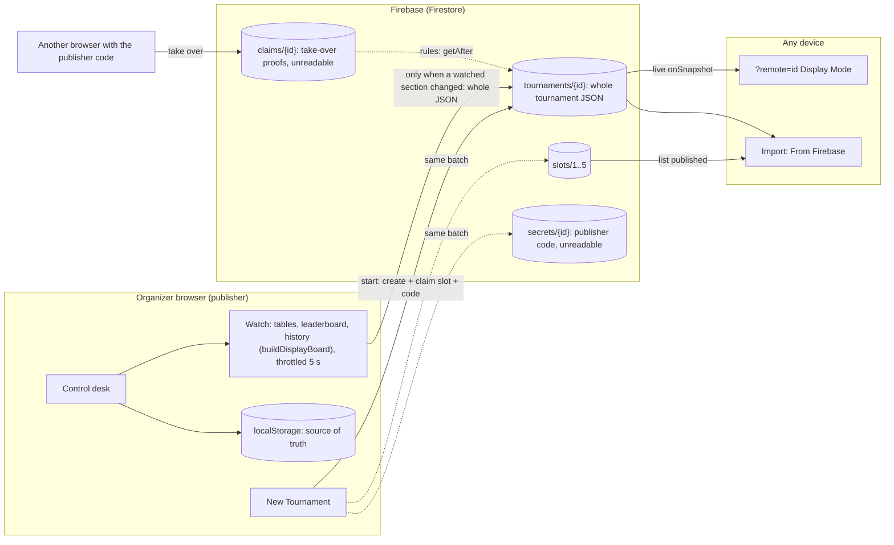
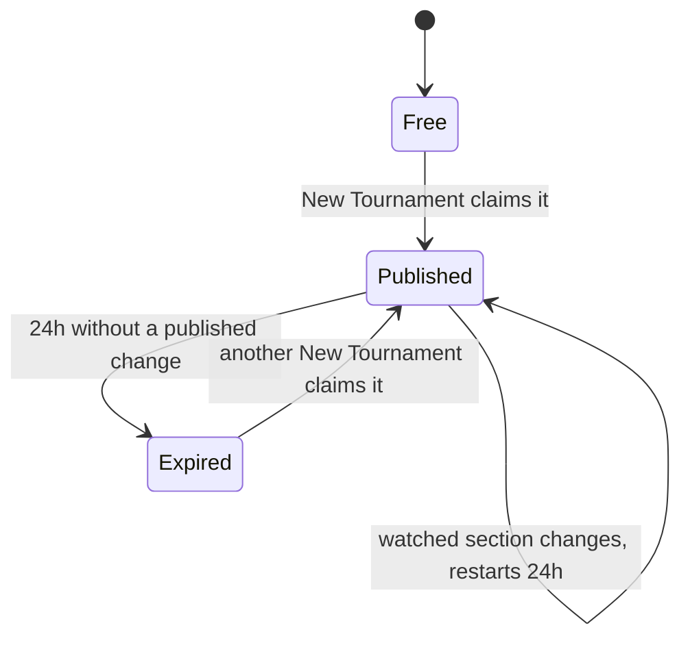

# Firebase publishing plan

Status: proposal, not built. The import dialog already lists **From Firebase** as "coming soon".

## Goal

When an organizer starts a **New Tournament**, it is published to Firebase automatically, without
sign-up, so that:

- anyone with the link can watch it live in Display Mode on any device (TVs, players' phones), and
- anyone can bring it into their own browser through **Import… → From Firebase**, using the existing
  review dialog (Add, Replace, Keep Both, View Read-only).

Firebase holds the whole tournament as JSON, shared with every listener. It is only written when the
tournament starts and when the parts viewers see change: **table status, the leaderboard and match
history**. `localStorage` stays the source of truth.

## Assumptions (agreed)

| Topic          | Decision                                                                                                                                                    |
| -------------- | ----------------------------------------------------------------------------------------------------------------------------------------------------------- |
| When it starts | **New Tournament** starts publishing: the new tournament is published at once.                                                                              |
| What is sent   | The whole tournament as JSON (the **Export JSON** envelope), except the admin PIN and lock, which belong to one device and must not be public.              |
| When it's sent | At the start, then only when table status, the leaderboard or match history change, at most once every 5 seconds. Other edits ride along in the next write. |
| Who can read   | Anyone with the link. Every listener gets the same document.                                                                                                |
| Identity       | Firebase **Anonymous Authentication**: each browser gets a silent `uid`, with no login screen or account.                                                   |
| Publisher      | The browser that starts the tournament owns it (`ownerUid`). Only the owner can change it.                                                                  |
| Capacity       | **5 slots**: at most 5 published tournaments at a time.                                                                                                     |
| Expiry         | A slot expires **24 hours after the publisher's last published change**. Anyone can then claim it, which removes the old tournament.                        |
| Abuse controls | **No CAPTCHA / App Check.**                                                                                                                                 |
| Hand-over      | A **publisher code** lets another browser take over publishing.                                                                                             |
| Plan           | Firebase free (Spark) plan. No Cloud Functions, so everything is enforced by security rules.                                                                |
| Future         | Google sign-in, linked to the anonymous account (see [Future: Google sign-in](#future-google-sign-in)).                                                     |

## Everything sent to Firebase

This is the complete list. Anything not here is not sent.

| When                                               | What is written                                                                                                                 |
| -------------------------------------------------- | ------------------------------------------------------------------------------------------------------------------------------- |
| **New Tournament** is started                      | Anonymous sign-in (Firebase Auth, no data), then one batch: the tournament JSON, the slot claim, and the publisher code secret. |
| **A watched section changes** (throttled to 5 s)   | One update replacing the tournament JSON, with a server timestamp.                                                              |
| **Take over publishing** (someone enters the code) | One batch: the take-over proof and the new owner.                                                                               |

The watched sections are exactly what Display Mode shows, compared with what was last sent:

| Section       | Changes when                                                                                   |
| ------------- | ---------------------------------------------------------------------------------------------- |
| Table status  | A match is drawn, finished or deleted, a bracket match gets a table, or a game score is typed. |
| Leaderboard   | A result changes the standings, or a player is added, renamed, removed, paused or unpaused.    |
| Match history | A match is completed, or results are cleared.                                                  |

Edits that don't change those sections (paid flags, settings, bracket options, the lock, saving,
importing or exporting) send nothing on their own. Because each write carries the whole tournament,
they reach Firebase with the next write a watched change triggers. There is no "unpublish" message: a
tournament stops changing and its slot frees 24 hours after its last change.

## Architecture



## Data model (Firestore)

| Path               | Readable by | Fields                                                                                                                                         |
| ------------------ | ----------- | ---------------------------------------------------------------------------------------------------------------------------------------------- |
| `tournaments/{id}` | anyone      | `ownerUid`, `slot` (1-5), `updatedAt` (server time), `name`, `startedAt`, `export`: the **Export JSON** envelope (format, version, tournament) |
| `slots/{1..5}`     | anyone      | `tournamentId`, `ownerUid`. Written only when claimed or taken over. A missing document means the slot is free.                                |
| `secrets/{id}`     | **nobody**  | `code`: the publisher code. Rules can still read it with `get()`.                                                                              |
| `claims/{id}`      | **nobody**  | `uid`, `code`: written by a browser taking over, checked by rules.                                                                             |

- `{id}` is the tournament's existing UUID (`tournamentId`).
- `export` reuses `serializeTournamentExport` and `parseTournamentExport`, so a published tournament
  gets the same deep validation as a file, and imports through the same dialog. The published copy has
  `adminPin: null` and `isLocked: false`.
- Tournaments are far below Firestore's 1 MiB document limit.
- `updatedAt` is always the server's `request.time`. Expiry is read from the tournament document, so a
  routine update touches only that one document.

## Security rules (outline)

```
function tournamentOf(slot) { return get(/databases/$(database)/documents/tournaments/$(slot.data.tournamentId)); }
function expired(slot) { return tournamentOf(slot).data.updatedAt < request.time - duration.value(24, 'h'); }
```

| Action                      | Allowed when                                                                                                                                                                                                                                                                                                                                          |
| --------------------------- | ----------------------------------------------------------------------------------------------------------------------------------------------------------------------------------------------------------------------------------------------------------------------------------------------------------------------------------------------------- |
| Read `tournaments`, `slots` | Always.                                                                                                                                                                                                                                                                                                                                               |
| Read `secrets`, `claims`    | Never.                                                                                                                                                                                                                                                                                                                                                |
| **Start publishing**        | Signed in; slot `n` is free or `expired`; in one batch the slot gets `{ tournamentId: id, ownerUid: uid }`, `tournaments/{id}` is created with `ownerUid = uid`, `slot = n`, `updatedAt = request.time`, and `secrets/{id}` is created (checked with `getAfter`). The batch may delete the expired tournament, secret and claim of the slot it takes. |
| **Publish a change**        | Signed in as the tournament's `ownerUid`; only `export`, `name` and `updatedAt` change; `updatedAt == request.time`; the slot still points at this tournament.                                                                                                                                                                                        |
| **Take over** with the code | One batch writes `claims/{id}` with `{ uid, code }` where `code == get(secrets/{id}).code`, and sets `ownerUid = uid` on the tournament and its slot (checked with `getAfter(claims/{id})`).                                                                                                                                                          |
| Shape checks                | Tournament documents may only contain the listed fields, and `export.tournament.adminPin` must be `null`.                                                                                                                                                                                                                                             |
| Anything else               | Denied.                                                                                                                                                                                                                                                                                                                                               |

The publisher code never appears in a readable document. `secrets` and `claims` are unreadable, and
rules read them server-side.

## Publisher code

- Generated in the browser when New Tournament starts publishing: 12 random characters from a
  32-character alphabet without look-alikes (Crockford base32), shown as `XXXX-XXXX-XXXX` (60 bits, so
  guessing is not practical even without a CAPTCHA). Kept in `localStorage` with the tournament.
- Shown with **Copy** and **Save code to file**. The file, `<tournament name>_<date>.publisher-code.txt`
  (saved through `downloadText`), holds the tournament name, its id, the viewer link, the code and a
  one-line note on taking over. Treat it like a password: anyone with it can take over publishing.
- The repo's `.gitignore` excludes `*.publisher-code.txt`, so a code file saved into a working copy can
  never be committed by accident.
- **Take over publishing** on another browser: enter the code, or pick the saved code file. That browser
  imports the published tournament from Firebase (the whole JSON is there) and becomes its publisher.
  The old browser's next write fails with "Publishing moved to another device". The code stays the same,
  so it can move again later.
- If both the browser and the code are lost, the tournament can't be changed again, but anyone can still
  import it. Its slot frees 24 hours after its last change.

## Slots and expiry



- On New Tournament, the browser picks a free slot, or else the oldest expired one, and claims it in a
  transaction, retrying another slot if it loses a race.
- When all 5 are in use, the tournament runs normally but unpublished, and the control desk shows "All 5
  publishing slots are in use. The next one frees at 9:40 PM". It tries again at the next watched change
  after that time.
- Reopening a tournament this browser already publishes (from Saved Tournaments) resumes publishing its
  watched changes, as long as it still owns the slot. Other tournaments it opens or imports are not
  published.
- Expired tournaments stay readable until their slot is claimed. Listeners then see "This tournament is
  no longer published".

## Client changes

### `tournament-logic.js` (pure, 100% unit-tested)

- `watchedSections(board)` picks table status, leaderboard and history from `buildDisplayBoard` output.
  `watchedChanged(previous, next)` says whether any of them changed since the last write.
- `publishedTournament(state)`: the Export JSON envelope with `adminPin: null` and `isLocked: false`.
- `publishThrottle(lastSentAt, now, 5000)`: at most one write every 5 seconds, with a trailing write for
  the latest state.
- `generatePublisherCode(random)`, `formatPublisherCode(code)`, `normalizePublisherCode(input)`,
  `publisherCodeFile(state, code, viewerUrl)` and `parsePublisherCodeFile(text)`.
- `isSlotExpired(updatedAt, now)` and `nextFreeSlot(slots, tournaments, now)` (free first, then the
  oldest expired).
- `remoteTournamentUrl(href, id)` and `isRemoteViewUrl(search)` for `?remote=<id>`.

### `firebase-remote.js` (new, thin adapter, classic script)

Wraps the Firebase SDK behind one small interface: `signIn()`, `startPublishing(doc, code)`,
`publish(id, doc)`, `takeOver(id, code)`, `listTournaments()`, `fetchTournament(id)`,
`subscribe(id, onChange)`. UI tests inject a fake with the same interface that records every call, so
tests can assert exactly when something was sent.

### `TournamentManager.html`

- Load the Firebase SDK (compat build) from `gstatic.com` at a pinned version, plus `firebase-config.js`
  (the project's public web config).
- **New Tournament** starts publishing the new tournament. An effect then watches `watchedSections`
  and, when they change, sends the whole tournament through the throttle. A `?display` window, a
  `?remote` listener and the read-only view never publish.
- **Publishing status** on the control desk: "Live at <link>" with **Copy**, the slot and expiry, the
  publisher code with **Copy** and **Save code to file**, **Take over publishing**, and the slots-full or
  "moved to another device" messages.
- **Import… → From Firebase**: lists the published tournaments (up to 5) and hands the chosen one to the
  existing review dialog (Add, Replace, Keep Both, View Read-only).
- **`?remote=<id>`**: Display Mode, read-only, subscribed with `onSnapshot`.

## Testing

| Layer          | How                                                                                                                                                                                                                                                                                                                                                                                                           |
| -------------- | ------------------------------------------------------------------------------------------------------------------------------------------------------------------------------------------------------------------------------------------------------------------------------------------------------------------------------------------------------------------------------------------------------------- |
| Module logic   | `node:test` unit tests, 100% coverage gate as today, including which edits count as watched changes and that the PIN is never in the published copy.                                                                                                                                                                                                                                                          |
| Security rules | `@firebase/rules-unit-testing` against the local Firestore emulator: every allowed and denied case in the rules table, expiry with mocked timestamps, races between two claimers, take-over with right and wrong codes, extra fields and a non-null PIN rejected.                                                                                                                                             |
| UI             | Puppeteer tests with a recording fake remote. **Nothing is sent before New Tournament.** Unwatched edits (paid flags, settings, the lock, saving, importing) send nothing until a watched change, which then carries them. Writes are throttled. Slot full, code shown, copied and saved, take-over (typed and from the file), From Firebase import, `?remote` live updates. The 100% UI-function gate stays. |
| End to end     | A small smoke suite against the emulator (real SDK, real rules), run in CI.                                                                                                                                                                                                                                                                                                                                   |

The emulator needs Java and `firebase-tools`. The build gets a **Firestore rules** step, skippable with
`--skip-firebase` where the emulator isn't available, as `--skip-e2e` is for Chrome.

## Phases

| Phase                | Work                                                                                                                                                                       | Done when                                                                                                                                          |
| -------------------- | -------------------------------------------------------------------------------------------------------------------------------------------------------------------------- | -------------------------------------------------------------------------------------------------------------------------------------------------- |
| **0. Project setup** | You create the Firebase project (club account), enable Firestore and Anonymous Auth, register the web app. I add `firebase.json`, `firestore.rules`, `firebase-config.js`. | `firebase deploy --only firestore:rules` works and the config loads.                                                                               |
| **1. Rules first**   | Write `firestore.rules` and the rules tests, emulator in CI.                                                                                                               | Every case in the rules table is tested. Unauthorized writes, extra fields, a PIN, reading codes and claiming active slots all fail.               |
| **2. Publish**       | Module helpers, adapter, publish on New Tournament, watched-section changes and throttle, slots and expiry, publisher code and code file, take-over.                       | New Tournament publishes, only watched changes send writes, the 24h clock restarts on each, and publishing moves to another browser with the code. |
| **3. Listen**        | `?remote=<id>` live Display Mode, **From Firebase** import, "no longer published" state.                                                                                   | A phone on another network follows a live tournament, and an organizer imports a published one.                                                    |
| **4. Polish**        | Slots-full message with next free time, docs and diagrams (README, Flow.md), deploy notes.                                                                                 | Full build green, including rules tests.                                                                                                           |

## Risks and trade-offs

| Risk           | Notes                                                                                                                                                                                                                                                                                                                   |
| -------------- | ----------------------------------------------------------------------------------------------------------------------------------------------------------------------------------------------------------------------------------------------------------------------------------------------------------------------- |
| Slot squatting | With no CAPTCHA and free anonymous ids, a script or one browser can hold all 5 slots, and keep them by publishing within 24 hours. Because New Tournament claims a slot, even clicking it a few times takes slots. Mitigations if it happens: App Check, a one-slot-per-browser rule, or Google sign-in for publishers. |
| Daily quota    | On the free plan, writes beyond the daily limit fail until the next day (no charges). Writing only on watched changes, at most once every 5 seconds, keeps a normal night well below it. Check Firebase's current Spark limits during Phase 0.                                                                          |
| Lost publisher | Recoverable with the publisher code. If both browser and code are lost, the tournament can still be imported, and its slot frees 24 hours after the last change.                                                                                                                                                        |
| Privacy        | The whole tournament is readable by anyone with the link (or by anyone listing the 5 slots): names, results, paid flags and settings, but not the PIN. Like the club's public leaderboard, but with more detail.                                                                                                        |
| Public config  | The Firebase web config is meant to be public. The security rules are the protection, which is why Phase 1 comes first.                                                                                                                                                                                                 |
| Clock skew     | All expiry uses server time (`request.time`), never the browser clock.                                                                                                                                                                                                                                                  |

## Future: Google sign-in

- Add **Sign in with Google** for organizers who want it. Firebase can link the anonymous account to
  the Google account, so the `uid`, and therefore ownership, carries over.
- A signed-in publisher can publish from any device without a code. The publisher code stays as the
  option for people who don't sign in.
- Optional organizer allowlist: rules could then let only listed accounts publish, which would remove
  the slot-squatting risk.
- Optional: per-organizer limits (for example one active slot each) become reliable, since Google
  accounts aren't free to mint in bulk the way anonymous ids are.

## Open questions

1. **Does a browser's very first tournament count as a New Tournament?** On a first visit the page
   creates a tournament without the button being pressed. The plan publishes only on **New
   Tournament**, so that first one stays local unless the organizer starts a new one.
2. **One slot per browser?** Not included, per the assumptions. It's one extra rule and stops a single
   browser from taking all 5 slots. It doesn't stop scripts minting new anonymous ids.
3. **Paid flags in the public copy?** The whole JSON includes who has paid. Leaving `paid` out, like
   the PIN, keeps that private without affecting imports much.
