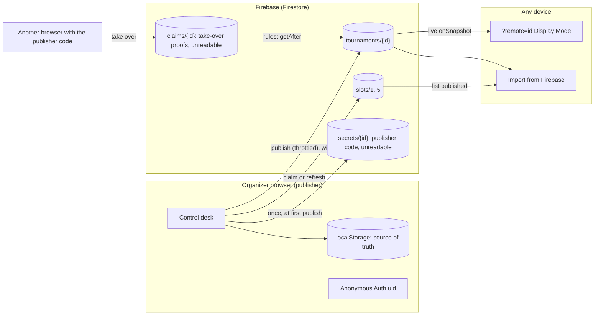
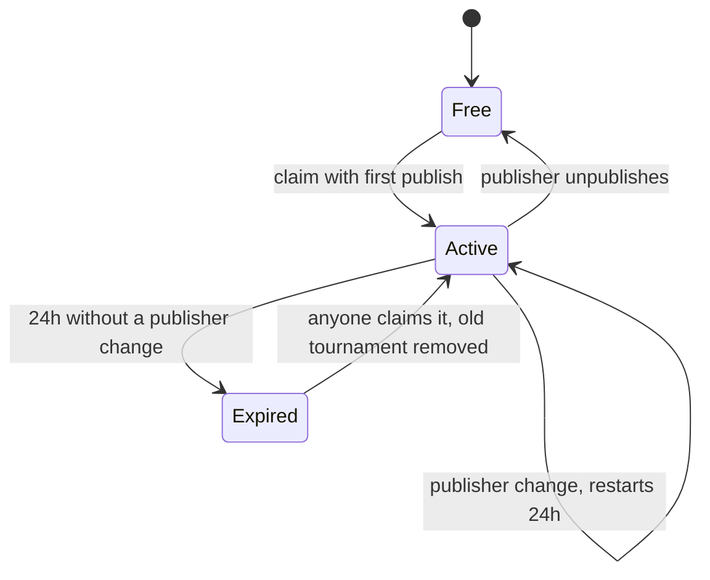

# Firebase publishing plan

Status: proposal, not built. The import dialog already lists **From Firebase** as "coming soon".

## Goal

Let an organizer publish the tournament they are running to Firebase without signing up, so that:

- anyone with the link can watch it live in Display Mode on any device (TVs, players' phones), and
- other organizers can import it through **Import… → From Firebase**, using the existing review dialog
  (Add, Replace, Keep Both, View Read-only).

The browser's `localStorage` stays the source of truth. Firebase holds a published copy.

## Assumptions (agreed)

| Topic          | Decision                                                                                                                   |
| -------------- | -------------------------------------------------------------------------------------------------------------------------- |
| Identity       | Firebase **Anonymous Authentication**: each browser gets a silent `uid`, with no login screen or account.                  |
| Publisher      | Whoever publishes a tournament first owns it (`ownerUid`). Only the owner can change it.                                   |
| Capacity       | **5 slots**: at most 5 published tournaments at a time.                                                                    |
| Expiry         | A slot expires **24 hours after the publisher's last change**. Anyone can then claim it, which removes the old tournament. |
| Abuse controls | **No CAPTCHA / App Check.**                                                                                                |
| Viewing        | Anyone with the link can read a published tournament.                                                                      |
| Hand-over      | A **publisher code** lets another browser take over publishing.                                                            |
| Plan           | Firebase free (Spark) plan. No Cloud Functions, so everything is enforced by security rules.                               |
| Future         | Google sign-in, linked to the anonymous account (see [Future: Google sign-in](#future-google-sign-in)).                    |

## Architecture



## Data model (Firestore)

| Path               | Readable by | Fields                                                                                                                                                 |
| ------------------ | ----------- | ------------------------------------------------------------------------------------------------------------------------------------------------------ |
| `tournaments/{id}` | anyone      | `ownerUid`, `slot` (1-5), `updatedAt` (server time), `name`, `startedAt`, `export` (the same envelope as **Export JSON**: format, version, tournament) |
| `slots/{1..5}`     | anyone      | `tournamentId`, `ownerUid`, `updatedAt`. A missing document means the slot is free.                                                                    |
| `secrets/{id}`     | **nobody**  | `code`: the publisher code. Rules can still read it with `get()`.                                                                                      |
| `claims/{id}`      | **nobody**  | `uid`, `code`: written by a browser taking over, checked by rules.                                                                                     |

- `{id}` is the tournament's existing UUID (`tournamentId`).
- The `export` field reuses `serializeTournamentExport` and `parseTournamentExport`, so published data
  gets the same deep validation as files. Tournaments are far below Firestore's 1 MiB document limit.
- `updatedAt` is always the server's `request.time`, never the browser clock.

## Security rules (outline)

Expiry is enforced by comparing stored server timestamps with `request.time`:

```
function expired(slot) {
  return slot.data.updatedAt < request.time - duration.value(24, 'h');
}
```

| Action                           | Allowed when                                                                                                                                                                                                           |
| -------------------------------- | ---------------------------------------------------------------------------------------------------------------------------------------------------------------------------------------------------------------------- |
| Read `tournaments`, `slots`      | Always.                                                                                                                                                                                                                |
| Read `secrets`, `claims`         | Never.                                                                                                                                                                                                                 |
| **Claim a slot** (first publish) | Signed in; slot `n` is free or `expired`; in the same batch the slot gets `ownerUid = uid`, `updatedAt = request.time`, and `tournaments/{id}` is created with `ownerUid = uid`, `slot = n` (checked with `getAfter`). |
| Remove an expired tournament     | The claimer may delete the old `tournaments`, `secrets` and `claims` documents of a slot it is claiming, in the same batch, only if that slot was `expired`.                                                           |
| **Publish an update**            | Signed in as `ownerUid`; the batch also sets the slot's `updatedAt = request.time` (so every publisher change restarts the 24-hour clock) and the slot still belongs to this tournament and uid.                       |
| Create `secrets/{id}`            | Once, by the tournament's owner, in the claiming batch. Never updated.                                                                                                                                                 |
| **Take over** with the code      | A batch writes `claims/{id}` with `{ uid, code }` where `code == get(secrets/{id}).code`, and changes `ownerUid` to `uid` on both `tournaments/{id}` and its slot (checked with `getAfter(claims/{id})`).              |
| Unpublish                        | The owner deletes their tournament, slot, secret and claim documents in one batch.                                                                                                                                     |
| Anything else                    | Denied.                                                                                                                                                                                                                |

The publisher code never appears in a readable document. `secrets` and `claims` are unreadable, and
rules read them server-side.

## Publisher code

- Generated in the browser at first publish: 12 random characters from a 32-character alphabet
  without look-alikes (Crockford base32), shown as `XXXX-XXXX-XXXX` (60 bits, so guessing is not
  practical even without a CAPTCHA).
- Shown once after publishing, with **Copy** and **Save code to file**. It can be shown again on the
  publishing browser, which keeps it in `localStorage` with the tournament.
- **Save code to file** downloads `<tournament name>_<date>.publisher-code.txt` (through
  `downloadText`, like the other exports). It holds the tournament name, its id, the viewer link, the
  code and a one-line note on taking over. Treat it like a password: anyone with the file can take over
  publishing.
- The repo's `.gitignore` excludes `*.publisher-code.txt`, so a code file saved into a working copy can
  never be committed by accident.
- **Take over publishing** (in the publish panel): enter the tournament link or id and the code, or pick
  the saved `.publisher-code.txt` file, which fills both in. On
  success that browser becomes the publisher, and the old browser's next publish fails with "Publishing
  moved to another device". The code stays the same, so it can move again later.
- If both the browser and the code are lost, the tournament can't be changed again. Its slot frees 24
  hours after the last change.

## Slots and expiry



- The publishing browser picks a free slot, or else the oldest expired one, and claims it in a
  transaction, retrying another slot if it loses a race.
- When all 5 are active, publishing explains it: "All 5 publishing slots are in use. The next one frees
  at 9:40 PM" (read from the slots' `updatedAt`).
- Expired tournaments stay readable until someone claims their slot. Viewers then see "This tournament
  is no longer published".

## Client changes

### `tournament-logic.js` (pure, 100% unit-tested)

- `generatePublisherCode(random)`, `formatPublisherCode(code)`, `normalizePublisherCode(input)`.
- `publisherCodeFile(state, code, viewerUrl)` returns `{ text, fileName }` for **Save code to file**,
  and `parsePublisherCodeFile(text)` returns `{ tournamentId, code }` or `{ error }` for take-over.
- `isSlotExpired(slot, now)`, `nextFreeSlot(slots, now)` (free first, then the oldest expired).
- `buildPublishedTournament(state, uid, slot)` and `parsePublishedTournament(doc)` (reuse the export
  helpers and `invalidFields`).
- `publishThrottle(lastPublishedAt, now, intervalMs)`: auto-publish at most every 10 seconds, plus a
  final publish after the last change.
- `remoteTournamentUrl(href, id)` and `isRemoteViewUrl(search)` for `?remote=<id>`.

### `firebase-remote.js` (new, thin adapter, classic script)

Wraps the Firebase SDK behind one small interface that the page uses:
`signIn()`, `listSlots()`, `publish(tournament)`, `unpublish(id)`, `takeOver(id, code)`,
`subscribe(id, onChange)`, `fetchTournament(id)`. UI tests inject a fake with the same interface, so
the UI suite stays fast and offline from Firebase.

### `TournamentManager.html`

- Load the Firebase SDK (compat build) from `gstatic.com` at a pinned version, plus `firebase-config.js`
  (the project's public web config).
- **Publish panel** (control desk): Publish / Unpublish, live status ("Published in slot 3, expires
  10:15 PM tomorrow"), the viewer link with **Copy**, the publisher code with **Copy** and **Save code
  to file**, and **Take over publishing** (typed code or code file).
- **Import… → From Firebase**: lists the published tournaments (up to 5) and hands the chosen one to
  the existing review dialog.
- **`?remote=<id>`**: Display Mode, read-only, subscribed with `onSnapshot`. It never writes to
  Firebase or `localStorage`, like the `?display` window today.
- Locked or read-only views can't publish. Viewing and importing stay available.

## Testing

| Layer          | How                                                                                                                                                                                                                                             |
| -------------- | ----------------------------------------------------------------------------------------------------------------------------------------------------------------------------------------------------------------------------------------------- |
| Module logic   | `node:test` unit tests, 100% coverage gate as today.                                                                                                                                                                                            |
| Security rules | `@firebase/rules-unit-testing` against the local Firestore emulator: every allowed and denied case in the rules table, including expiry with mocked timestamps, races between two claimers, and take-over with right and wrong codes.           |
| UI             | Puppeteer tests with a fake remote: publish, slot full, code shown, copied and saved to a file, take-over (typed and from the file), From Firebase import, `?remote` live updates, never writing from viewers. The 100% UI-function gate stays. |
| End to end     | A small smoke suite against the emulator (real SDK, real rules), run in CI.                                                                                                                                                                     |

The emulator needs Java and `firebase-tools`. The build gets a **Firestore rules** step, skippable with
`--skip-firebase` where the emulator isn't available, as `--skip-e2e` is for Chrome.

## Phases

| Phase                  | Work                                                                                                                                                                       | Done when                                                                                                               |
| ---------------------- | -------------------------------------------------------------------------------------------------------------------------------------------------------------------------- | ----------------------------------------------------------------------------------------------------------------------- |
| **0. Project setup**   | You create the Firebase project (club account), enable Firestore and Anonymous Auth, register the web app. I add `firebase.json`, `firestore.rules`, `firebase-config.js`. | `firebase deploy --only firestore:rules` works and the config loads.                                                    |
| **1. Rules first**     | Write `firestore.rules` and the rules tests, emulator in CI.                                                                                                               | Every case in the rules table is tested. Unauthorized writes, reading codes and claiming active slots all fail.         |
| **2. Publish**         | Module helpers, adapter, publish panel, slots, expiry messaging, publisher code, take-over.                                                                                | A tournament publishes, refreshes its 24h clock on changes, shows its code, and moves to another browser with the code. |
| **3. View and import** | `?remote=<id>` live Display Mode, **From Firebase** import, "no longer published" state.                                                                                   | A phone on another network follows a live tournament, and an organizer imports a published one.                         |
| **4. Polish**          | Throttled auto-publish, slot-full message with next free time, docs and diagrams (README, Flow.md), deploy notes.                                                          | Full build green, including rules tests.                                                                                |

## Risks and trade-offs

| Risk           | Notes                                                                                                                                                                                                                                      |
| -------------- | ------------------------------------------------------------------------------------------------------------------------------------------------------------------------------------------------------------------------------------------ |
| Slot squatting | With no CAPTCHA and free anonymous ids, a script or one browser can hold all 5 slots, and keep them by touching them within 24 hours. Mitigations if it happens: App Check, a one-slot-per-browser rule, or Google sign-in for publishers. |
| Daily quota    | On the free plan, writes beyond the daily limit fail until the next day (no charges). Throttled auto-publish keeps a normal night well below it. Check Firebase's current Spark limits during Phase 0.                                     |
| Lost publisher | Recoverable with the publisher code. If both browser and code are lost, the slot frees 24 hours after the last change.                                                                                                                     |
| Privacy        | Published names and results are readable by anyone with the link (or by anyone listing the 5 slots), like the club's public leaderboard.                                                                                                   |
| Public config  | The Firebase web config is meant to be public. The security rules are the protection, which is why Phase 1 comes first.                                                                                                                    |
| Clock skew     | All expiry uses server time (`request.time`), never the browser clock.                                                                                                                                                                     |

## Future: Google sign-in

- Add **Sign in with Google** for organizers who want it. Firebase can link the anonymous account to
  the Google account, so the `uid`, and therefore ownership, carries over.
- A signed-in publisher can publish from any device without a code. The publisher code stays as the
  option for people who don't sign in.
- Optional organizer allowlist: rules could then let only listed accounts publish, which would remove
  the slot-squatting risk.
- Optional: per-organizer limits (for example one active slot each) become reliable, since Google
  accounts aren't free to mint in bulk the way anonymous ids are.

## Open questions

1. **One slot per browser?** Not included, per the assumptions. It's one extra rule and stops a single
   browser from taking all 5 slots. It doesn't stop scripts minting new anonymous ids.
2. **Auto-publish or manual?** The plan assumes a Publish toggle that then auto-publishes (throttled),
   which is what makes live viewing work.
3. **Should the 5 published tournaments be listable by anyone**, or only viewable with a direct link?
   Listing is what makes **From Firebase** import simple.
